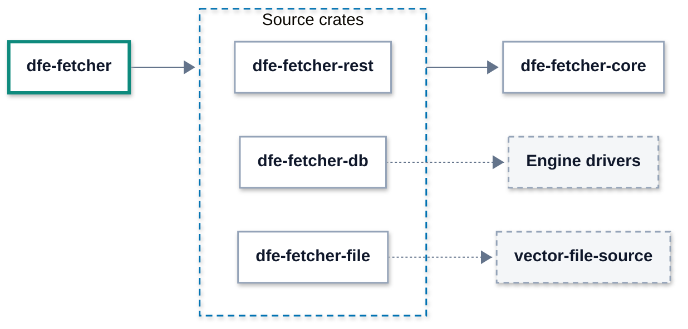

# Contributing

We welcome contributions to this project. By contributing, you agree to the
terms outlined below.

## Commit Message Format

HyperI projects use [Conventional Commits](https://www.conventionalcommits.org/)
and [semantic-release](https://semantic-release.gitbook.io/) for automated
versioning and changelog generation. All commits must follow this format:

```text
<type>(<scope>): <subject>

[optional body]

[optional footer(s)]
```

### Types

| Type | Description | Version Bump |
|------|-------------|--------------|
| `feat` | A new feature | Minor (0.X.0) |
| `fix` | A bug fix | Patch (0.0.X) |
| `docs` | Documentation | None |
| `style` | Code style (formatting, semicolons, etc.) | None |
| `refactor` | Code change that neither fixes a bug nor adds a feature | None |
| `perf` | Performance improvement | Patch (0.0.X) |
| `test` | Adding or correcting tests | None |
| `build` | Changes to build system or dependencies | None |
| `ci` | Changes to CI configuration | None |
| `chore` | Other changes that don't modify src or test files | None |
| `revert` | Reverts a previous commit | Patch (0.0.X) |

### Breaking Changes

For breaking changes that require a major version bump, add `!` after the type
or include `BREAKING CHANGE:` in the footer:

```text
feat!: remove deprecated API endpoints

BREAKING CHANGE: The /v1/users endpoint has been removed. Use /v2/users instead.
```

### Examples

```text
feat(auth): add OAuth2 support for Google login

fix(api): handle null response from upstream service

docs: update installation instructions for Windows

refactor(core)!: restructure module exports

BREAKING CHANGE: Named exports are now used instead of default exports.
```

### Scope

Scope is optional but recommended. Use it to indicate the area of the codebase
affected (e.g., `api`, `auth`, `core`, `cli`, `docs`).

## Semantic Versioning

This project follows [Semantic Versioning 2.0.0](https://semver.org/):

- MAJOR (X.0.0): breaking changes that require users to modify their code
- MINOR (0.X.0): new features that are backwards-compatible
- PATCH (0.0.X): bug fixes and minor improvements

Versions are automatically determined by semantic-release based on commit
messages. Do not manually update version numbers.

## License for Contributions

All contributions to this project are licensed under the Business Source
License 1.1 (BUSL-1.1), the same license that covers the project.

Each version of the software (including your contributions) will automatically
become available under the Apache License, Version 2.0 on the third
anniversary of its release.

## How to Contribute

1. Fork the repository and create your branch from `main`
2. Make your changes following the commit message format above
3. Run the tests that cover your change
4. Submit a pull request with a clear description of what you've done

### Pull Request Checklist

- [ ] Commits follow the conventional commit format
- [ ] Tests pass (if applicable)
- [ ] Documentation is updated (if applicable)

## Run the checks locally before you push

HyperI projects gate every push through CI (lint, format, tests, secret scan,
dependency audit, build). Run the SAME checks locally first so your change passes
instead of bouncing:

```bash
hyperi-ci check
```

`hyperi-ci` is the HyperI CI CLI (public on PyPI). If you do not have it, install
it once with `uv tool install hyperi-ci` (or `pipx install hyperi-ci`), or run it
ad hoc with `uvx hyperi-ci check`. It runs the project's full local validation --
the same suite CI runs -- and reports what to fix. Run it before every push and before opening a
pull request. It is the single best way to give your change the best chance of
surviving CI.

## CI/CD Workflow

A merge to `main` runs CI and releases nothing by itself. A release is cut when the squash-merge commit ends with a `Release: true` trailer, or when a maintainer dispatches the CI workflow with `from-head: true`. semantic-release then reads the commit messages since the last release and picks the next version, the release commit updates `CHANGELOG.md` and `VERSION`, and hyperi-ci builds and publishes the release.

## Context

### What this is

A Rust service that PULLS. It polls external providers -- cloud and SaaS APIs
over REST, databases, files -- and hands each record to the DFE pipeline over
Kafka or gRPC. Every REST provider is a declarative YAML profile run by one
generic driver, so adding a REST source is data, not Rust.

It is not a default component on the Kubernetes tiers. `dfe-infra/apps.yaml` gives it `multiplicity: per_config`, so the engine writes one fetcher deployment per configured source when that source is written, binding `config.instance_id` to the source, and `default_in: [docker-single]`, where one fetcher starts idle and every instance's sources merge into its one file (`shared_instance: config.sources`). `scale_deployed: false` -- KEDA does not drive it. Compare dfe-receiver in the same manifest, which is `single` and `scale_deployed: true`.

Every provider connection is outbound: this service dials, nothing dials in.
Both inbound listeners ship off -- the ingest HTTP endpoint on 8080
(`IngestConfig::default().enabled` is false) and the Vector gRPC receiver on
6000 (`VectorExtractorConfig::default().enabled` likewise), both in
`crates/fetcher/src/config/mod.rs`. Metrics and health on 9090 are what listen by
default. So grade a dependency advisory here by reachability first and severity
second: the same advisory in dfe-receiver, which takes untrusted input, is a
different finding. `dfe-infra/docs/threat-model.md` is the source of truth for
that, and an entry in its accepted-risks table is settled. The one way to hand
this service untrusted input is running ingest open:
`/ingest/{source}/{topic}` takes the destination topic from the URL, so an open
listener lets anything that can reach the port write to any topic. An enabled
listener with no `auth_token` will not start unless
`ingest.allow_unauthenticated` is set.

### Where things live

| Path | What it holds |
|---|---|
| `crates/core` | The I/O-free framework: row model, batcher, compiled per-row rules, snapshot envelope, checkpoint contract. Names no HTTP client, no transport, no file. |
| `crates/rest` | The REST profile grammar and its runtime axes -- auth modes, pagers, decoders, the request executor, the hooks. |
| `crates/db`, `crates/file` | The database and file sources. The engines and the tailer are feature-gated, and the grammars are always linked. |
| `crates/fetcher` | The binary: config cascade and hot reload, scheduler, the per-tick `Driver`, pipeline, output transports, cursor store, ingest server, Vector and container extractors. |
| `crates/fetcher/profiles/*.yaml` | The shipped REST profiles. Each is registered in `crates/fetcher/src/profiles/mod.rs`. |
| `crates/fetcher/src/deployment.rs` | The deployment contract, and the drift tests that hold the generated artefacts to it. The released chart is assembled from it, never committed. |
| `Dockerfile`, `docs/config-schema.*`, `docs/capability-catalog.*` | Generated from that contract and committed. Never hand-edited -- see below. |
| `third-party/vector-file-source{,-common}` | Vector's file tailer (MIT), copied in, and `crates/file` is the one crate that depends on it, by path. |
| `scripts/generics_gates.py` | The generics acceptance gates: one framework site per provider mechanism, the crate dependency direction, per-hook line budgets. |
| `config.example.yaml` | The annotated reference. `docs/config-schema.yaml` is the generated list of every key. |
| `docs/architecture.md` | The parts, how data flows and why. Each part's page is linked from its Components table. |

The workspace is one I/O-free core, three source crates off it and the app on top. The source crates compile in parallel, and a profile change never rebuilds a database driver.



*Figure 1. L4 Detail -- Workspace crates. Engine drivers and vector-file-source are not ours, and the arrows to them are behind a cargo feature.* Up: [L3 Components -- dfe-fetcher](docs/architecture.md).

The app depends on `dfe-fetcher-core` directly as well, and links all four crates unconditionally, so a `sources.db` or `sources.file` block is always parsed and validated. The features decide whether the engine behind it is present: `db-odbc`, `db-clickhouse`, `db-mongodb`, `db-hana` and `file-tail`, named `<capability>-<backend>` as in scalo. Beside them are `file` (the dump is always built), `jemalloc`, `full` and `pgo-driver`. The shipped profiles are `include_str!`'d into the app, so editing one rebuilds the app alone.

Rules the crate graph holds:

- `dfe-fetcher-core` depends on no other workspace crate, and on scalo for `expression` and `rules` alone. It names no HTTP client, transport or file. tokio is linked for its clock types and once-cell, and never spawns a task there.
- `rest`, `db` and `file` depend on `core` and never on each other or the app. None sends to a transport, writes a cursor or reads the config cascade. Each receives bound units and yields rows.
- The app never re-implements a source, pager, decoder or auth mode. There is no per-provider Rust in it: a provider is a profile, and what a profile can't say is a hook on an axis in `crates/rest`.
- No crate depends on a Vector crate from a registry. The tailer is the copy under `third-party/`, depended on by path from `dfe-fetcher-file` alone.
- Nothing deployment-specific: no hostnames, addresses, vault paths or licence detail outside `config.example.yaml` placeholders and tests.

The fetcher skips the hot-path rules the loader and receiver follow: `serde_json` over `sonic-rs`, an allocation per row, a mutex around a token cache. The driver's two shortcuts (fetch and emit don't overlap, and the row stream is boxed) are marked in `crates/fetcher/src/driver.rs` with the measurement that would lift them. Measure a source before changing them.

### Commands that prove a change

```bash
make check    # the generics gates, then hyperi-ci check
make gates    # the gates alone -- deterministic, needs python3, git and cargo
```

The gates run in the test stage, as the integration test `the_generics_gates_hold`, so CI and `hyperi-ci check` fail a broken gate as well. `make gates` is the quick way to run them alone, from a git checkout.

The generated files are regenerated from the binary: `dfe-fetcher emit-dockerfile > Dockerfile`, and `dfe-fetcher config-schema --dir docs` for the schema and catalogue under `docs/`. To see the chart a release would ship, build the binary and run `hyperi-ci chart assemble --binary target/debug/dfe-fetcher --image ghcr.io/hyperi-io/dfe-fetcher:<tag>@sha256:<digest>`, which prints the directory it wrote.

Two ways a passing run says more than it proved:

- The feature sets in `.hyperi-ci.yaml` are listed one by one, never `--all-features`.
  Test and Quality cover `db-clickhouse`, `db-mongodb`, `db-hana`, `file-tail` and `db-odbc`.
  The `db-odbc` suites need unixODBC, its headers and the `odbc-postgresql` and
  `odbc-mariadb` drivers: hyperi-ci installs them on the runner when `Cargo.lock`
  names `odbc-sys`, and a missing driver fails the test in CI. The SQL Server and
  Oracle suites skip by name where their proprietary driver is absent, so a passing
  run has not exercised those two. Locally,
  `cargo nextest run --workspace --all-features` runs the same suites and needs
  `libodbc`, its headers and those drivers on your host.
- Live provider tests are `#[ignore]`. A passing run has not talked to AWS, Okta
  or any other provider. Each `docs/cloud-setup/*.md` says how to run that provider's tests.

### What tends to bite

| Don't | Do | Why |
|---|---|---|
| Hand-edit `Dockerfile` or the generated files under `docs/`, or commit a chart | Change `crates/fetcher/src/deployment.rs` and regenerate | The Dockerfile is generator output and the release assembles the chart from the contract, so a hand edit is reverted or never ships, and a committed chart drifts from the contract the release renders. `checked_in_dockerfile_matches_generated` names the regenerate command in its failure, and `test_config_artifacts_do_not_drift` holds the generated schema and catalogue under `docs/` to it. |
| Bump scalo and stop there | Regenerate the artefacts and move `release.helm.library` in `.hyperi-ci.yaml` to the same version, in the same change | scalo owns the generators -- the Dockerfile banner names `scalo::deployment::generate_dockerfile()` and the schema version it emitted -- and a scalo-service release renders the contract version its scalo release writes and no other. A release that moves a generator fails the drift tests until the files are regenerated. That is the guard working, not a spurious failure. |
| Add a secret env var to a deployment by hand | Add it to the contract's `secrets` and its field to `SECRET_FIELDS` in `config_reachability.rs` | The chart mounts the contract's secret groups and nothing else, so a name added by hand to one deployment is in no chart, no contract and no test. Both env spellings reach the field (`DFE_FETCHER_KAFKA__SASL__USERNAME` and `DFE_FETCHER__KAFKA__SASL__USERNAME` alike), so the name is not the risk, its absence from the contract is. `every_declared_secret_env_var_reaches_the_config` sets each declared name and checks the one field it fills. |
| Write a secret spec with a path and no mount in front of it | Write `vault:<mount>/<path>:<key>` | scalo reads the first segment as the KV v2 mount, and a `data` segment after it is accepted and ignored. A spec with a single segment is filed under the default `secret` mount, which is not the mount a reader of that spec would guess, and a wrong guess fails at fetch time, not at config load. `every_documented_vault_spec_names_a_mount_and_a_path` scans README.md, config.example.yaml and every doc under `docs/` for this spec, which is why the wrong form is described here rather than spelled out: a counter-example written in full fails that test. |
| Add a config knob and assume it lands | Add a case to `crates/fetcher/tests/integration/config_reachability.rs` | `metrics.address` shipped in the old chart's values, the contract default and `config.example.yaml`, and was read by nothing: the runtime resolves it from scalo's cascade, which `--config` did not populate, so the listener bound the hard-coded default. Every failure in this class looks identical from outside -- the process starts, logs a healthy line, and runs on a value the operator did not set. |
| Sleep to wait for a tick, a tail or a file timestamp | Bound the wait on the thing itself, or cross the boundary | Repeated flakes: `8e205c5` bounded the file-tail and dump-listing races instead of sleeping, `33b53aa` crossed a second boundary instead of polling for a change time, `9dfb307` used a port nothing can bind rather than one just handed back. |
| Add per-provider Rust | Write a profile, or add a variant on the matching axis in `crates/rest` | The generics gates fail a provider mechanism written twice, and every hook has a line budget. `741e28c` is the gate itself being fixed after it matched the word "sigv4" in a comment instead of a signer. |
| Share an `instance_id` between fetchers, or change one | One stable id per deployment, which dfe-infra binds to its source | Every cursor key starts with the instance id, so two fetchers sharing one read and write each other's windows, and a changed id starts every connection cold on the default window. An unset id that would fall back to the shared default is refused once more than one source runs. |

### Where this sits

Generated with `python3 ../dfe-infra/scripts/dfe-stack suite --consumer
dfe-fetcher` and `--producer dfe-fetcher`. Nothing else in the suite graph names
this repo in either direction.

| Repo | Direction | How it interacts |
|---|---|---|
| scalo-rs | inbound -- this repo depends on it | `cargo-dep`. The workspace manifest declares `scalo` as a caret floor. A scalo release reaches here: if the floor admits it, `cargo update -p scalo` and rebuild, otherwise raise the floor first. |
| scalo-rs | inbound, lockstep | `generated-file`. The committed `Dockerfile` is written by `scalo::deployment::generate_dockerfile()`, and its banner names the generator and the contract schema version. A release that changes either needs the file regenerated and committed. The released chart is assembled on the scalo-service library chart at `release.helm.library`, which moves with the scalo version in `Cargo.toml`. |
| dfe-clickhouse-rs | inbound -- this repo depends on it | `cargo-dep`. `crates/db` declares `dfe-clickhouse` behind its `clickhouse` feature (the app's `db-clickhouse`), for the ping and the typed server exceptions. A release reaches here the way a scalo one does. |
| dfe-infra | outbound -- it depends on this | `image-pin`, lockstep. `dfe-infra/versions.yaml` pins this service's image and the thin chart released here, and Argo deploys that published chart. A release here is consumed by bumping the tag and re-resolving the digest. |
