# dfe-fetcher

Pulls data from cloud and SaaS APIs, databases and files into a DFE deployment.

[](https://github.com/hyperi-io/dfe-fetcher/actions)
[](LICENSE)

- A REST provider is a YAML profile, with no Rust: the base URL, auth modes, endpoints, decoder and pager, checked at load with the line of any unknown key.
- Database sources over ODBC, the ClickHouse HTTP interface and MongoDB, dumped whole or tailed, by key tuple on SQL and by change stream or `_id` on MongoDB.
- Any tool run in a Docker or podman container as a source, its stdout JSON lines or HTTP posts collected, and Vector's native gRPC protocol received.
- A cursor or checkpoint written once the transport has taken the batch, never before, so a failed tick fetches again rather than losing records. A dump travels as one snapshot, framed `begin`, rows and `end`.
- A per-source CEL filter, re-read every tick, and a memory brake that pauses polling a provider when the service is under memory pressure, for at most `self_regulation.max_hold_secs` at a time.
- Secrets from a secrets manager, an env var or a literal, config reload on SIGHUP or file watch, and a deployment contract that generates its Dockerfile, its Compose file and the released chart.

Every record goes to the DFE pipeline over Kafka or gRPC, the same way dfe-receiver's do.

## Architecture

Two input families feed one emit path. The source framework polls: a REST profile, a database or a file per connection. The extractors take what external tools hand over: a container's stdout, posts to the ingest endpoint and Vector's gRPC protocol. Any combination runs at once.

Records from the source framework and the extractors meet at the emitter, which sends them to the DFE pipeline and dead-letters what the transport rejects for good.

```mermaid
---
config:
  theme: base
  look: neo
  fontFamily: Inter, -apple-system, Segoe UI, Roboto, Helvetica, Arial, sans-serif
  flowchart:
    curve: linear
    nodeSpacing: 40
    rankSpacing: 64
    padding: 18
    wrappingWidth: 280
    htmlLabels: true
  elk:
    preset: modelOrder
  themeVariables:
    fontSize: 15px
    lineColor: "#64748B"
    primaryTextColor: "#0F172A"
    clusterBorder: "#0072B2"
    edgeLabelBackground: "#FFFFFF"
  themeCSS: >-
    p{margin:0}
    .node[data-look] rect,.node[data-look] path,.node[data-look] polygon,.node[data-look] .outer-path{filter:drop-shadow(0 1px 2px rgba(15,23,42,.10)) drop-shadow(0 6px 14px rgba(15,23,42,.10))}
    .node rect{rx:10px;ry:10px}
    .cluster rect{rx:16px;ry:16px}
    .node .label div{min-width:150px}
    .node.decision .label div{min-width:0}
    .cluster[data-look] rect{filter:none}
    .nodeLabel{line-height:1.35}
    .nodeLabel b{font-weight:600;font-size:15px;letter-spacing:-0.01em}
    .nodeLabel span{font-size:12.5px;font-weight:400;color:#334155}
    .cluster-label span.nodeLabel{display:inline-block;background:#FFFFFF;color:#0B2A3F;border:1.5px solid #0072B2;border-radius:999px;padding:2px 12px;font-size:11.5px;font-weight:700;letter-spacing:.09em;text-transform:uppercase}
    .flowchart-link{stroke-width:1.75px}
    .labelBkg{background:transparent!important}
    span.edgeLabel{display:inline-block;background:#FFFFFF!important;color:#1E293B;border:1px solid #94A3B8;border-radius:999px;padding:2px 10px;font-size:12px;font-weight:500}
    span.edgeLabel p{background:transparent!important}
    .label-icon{width:20px;height:20px;vertical-align:-4px;margin-right:6px}
    .ingest .label-icon{color:#0E8A7D}
    .xform .label-icon{color:#7B4FB0}
    .load .label-icon{color:#0072B2}
    .bus .label-icon{color:#A8517F}
    .store .label-icon{color:#00785A}
    .ui .label-icon{color:#D9480F}
    .ext .label-icon{color:#64748B}
---
flowchart LR
    accTitle: L3 Components -- dfe-fetcher
    accDescr: APIs, databases and files feed the source framework, and external tools feed the extractors. Both hand records to the emitter, which sends them through the output transport to the DFE pipeline and dead-letters a record the transport refuses for good, when a DLQ is configured.

    providers["<b>APIs, databases, files</b>"]
    tools["<b>External tools</b>"]

    subgraph fetcher["dfe-fetcher"]
        framework[["<b>Source framework</b>"]]
        extractors[["<b>Extractors</b>"]]
        emitter["<b>Emitter</b>"]
        output["<b>Output transport</b>"]
        dlq[("<b>Dead letters</b>")]
    end

    dfe["<b>DFE pipeline</b>"]

    providers -->|records| framework
    tools -->|records| extractors
    framework --> emitter
    extractors --> emitter
    emitter --> output
    emitter -.-> dlq
    output -->|records| dfe
  classDef ext fill:#F4F6F8,stroke:#94A3B8,stroke-width:1.5px,stroke-dasharray:5 4,color:#0F172A
  classDef ingest fill:#FFFFFF,stroke:#0E8A7D,stroke-width:3px,color:#0F172A
  classDef xform fill:#FFFFFF,stroke:#7B4FB0,stroke-width:3px,color:#0F172A
  classDef load fill:#FFFFFF,stroke:#0072B2,stroke-width:3px,color:#0F172A
  classDef bus fill:#FFFFFF,stroke:#A8517F,stroke-width:3px,color:#0F172A
  classDef store fill:#FFFFFF,stroke:#00785A,stroke-width:3px,color:#0F172A
  classDef ui fill:#FFFFFF,stroke:#D9480F,stroke-width:3px,color:#0F172A
  classDef decision fill:#FFFFFF,stroke:#9A6700,stroke-width:3px,color:#0F172A
  classDef error fill:#FFFFFF,stroke:#C2410C,stroke-width:3px,color:#0F172A
  classDef control fill:#FFFFFF,stroke:#334155,stroke-width:3px,color:#0F172A
  classDef part fill:#FFFFFF,stroke:#94A3B8,stroke-width:1.5px,color:#0F172A
  class providers,tools ext
  class framework,extractors,emitter,output part
  class dlq,dfe bus
  style fetcher fill:none,stroke:#0072B2,stroke-width:1.5px,stroke-dasharray:6 4
```



*Figure 1. L3 Components -- dfe-fetcher. Dashed boxes are external, and the dotted arrow is the dead-letter path.* Up: top of dfe-fetcher. Down: [L4 Detail -- Source framework](docs/internals.md#source-framework), [L4 Detail -- Extractors](docs/extractors.md).

The output transport is Kafka, gRPC or both. What the emitter does with each record, the dead letters and the delivery guarantees are in [docs/delivery.md](docs/delivery.md).

## Quick start

On Linux the build needs `protoc`, a C toolchain, `pkg-config` and librdkafka. scalo compiles its gRPC `.proto` files, `aws-lc-sys` compiles C, and `rdkafka-sys` links librdkafka through pkg-config. It rejects a librdkafka older than the version after the `+` in its `Cargo.lock` entry, and a Debian or Ubuntu package can be older than that, so there [build librdkafka from source](https://github.com/confluentinc/librdkafka#build-from-source) first.

```bash
sudo apt-get install -y protobuf-compiler build-essential pkg-config
cargo build --release
./target/release/dfe-fetcher --config config.example.yaml config-check
./target/release/dfe-fetcher --config config.example.yaml
```

`--config` goes before the subcommand. [config.example.yaml](config.example.yaml) enables no source, so the fetcher starts idle and logs `no work configured` until a source, an extractor or the ingest listener is switched on. Metrics and health answer on port 9090 (`/metrics`, `/livez`, `/readyz`), and `/readyz` answers `{"status":"ready"}` when idle. The ingest HTTP endpoint on 8080 and the Vector gRPC receiver on 6000 are off until a deployment turns them on.

A default build has the REST sources and the file dump. The database engines and the file tailer are cargo features of `crates/fetcher/Cargo.toml` (`db-odbc`, `db-clickhouse`, `db-mongodb`, `file-tail`), and a config naming an engine the binary lacks is refused at load with the feature to build. The release image is built with all four and `jemalloc` (`build.rust.features` in `.hyperi-ci.yaml`).

## Configuration

[config.example.yaml](config.example.yaml) is the annotated reference, [docs/config-schema.yaml](docs/config-schema.yaml) the generated list of every key, and [docs/reference/profile-grammar.md](docs/reference/profile-grammar.md) the profile grammar field by field. Settings load through a cascade: CLI flags, then `DFE_FETCHER_*` environment variables, then the config file, then defaults. The file is the one `--config` names, and there is no `DFE_FETCHER_CONFIG` variable. Without `--config`, scalo's search for `settings.yaml` and `defaults.yaml` stands in, with `.env` read from the working directory, as [docs/internals.md](docs/internals.md#configuration-cascade) sets out. Each provider has its typed block (`sources.aws`, `sources.okta`, and so on), and `sources.rest.<id>` takes a shipped or inline profile. A second account of a provider, or an API with no typed block, is a `sources.rest.<id>` instance. The id is the connection id: the cursor key, the metric and log label, and the prefix of `_source_fetcher` on every record.

Credential and identity fields take a spec: `vault:<mount>/<path>:<key>` (or its `bao:` and `openbao:` spellings), `env:NAME`, `file:<path>`, or a literal. Identity fields (tenant, account, client id and the like) resolve at startup, and one that cannot be resolved stops the process with a configuration error. A reload that changes a source resolves its specs again. A provider secret resolves on first use and is held until its source is rebuilt or the process restarts, so a secret rotated behind an unchanged spec takes a restart. An `aws:` spec is refused at load, because the fetcher is not built with the AWS Secrets Manager resolver. [Credentials in Kubernetes](docs/cloud-setup/README.md#credentials-in-kubernetes) shows how a deployment supplies them.

Each REST source is a shipped profile under `crates/fetcher/profiles/`, and databases and files are separate source kinds (`sources.db`, `sources.file`). A profile's `maturity` is repeated in [docs/capability-catalog.yaml](docs/capability-catalog.yaml), and the fetcher warns at startup for any enabled source that is not stable. [docs/cloud-setup/README.md](docs/cloud-setup/README.md) indexes the setup guides.

| Source | Block | What it pulls |
|--------|-------|---------------|
| AWS | `sources.aws` | CloudTrail, GuardDuty, Security Hub, Config, CloudWatch Logs and Metrics, Inspector v2, Health |
| Azure | `sources.azure` | Activity Log, Defender alerts, Sentinel incidents, the Entra ID audit feeds, Log Analytics queries |
| Microsoft 365 | `sources.m365` | Management Activity feeds (audit, DLP, Exchange), Graph security alerts |
| Google Cloud | `sources.gcp` | Cloud Audit Logs, VPC flow and DNS query logs, any Cloud Logging filter, Security Command Center findings |
| Google Cloud Pub/Sub, Google Workspace | `sources.gcp_pubsub`, `sources.google_workspace` | Pull subscriptions, Reports API activity |
| Okta, Cisco Duo, CrowdStrike, Cloudflare | `sources.okta`, `sources.duo`, `sources.crowdstrike`, `sources.cloudflare` | System Log, authentication logs, Falcon alerts, account audit logs |
| Datadog, runZero | `sources.rest` with the shipped profile | Audit trail and security signals, asset inventory snapshots |
| Bitwarden, 1Password, Slack, GitHub, Salesforce | `sources.bitwarden`, `sources.onepassword`, `sources.slack`, `sources.github`, `sources.salesforce` | Each product's audit and event logs |
| Object store | `sources.object_store` | S3 and S3-compatible bucket prefixes, each object read at least once |
| PyPI, crates.io, Go modules | `sources.pypi`, `sources.crates_io`, `sources.go_modules` | Package metadata for supply-chain monitoring |
| Databases | `sources.db` | Any ODBC-reachable database, ClickHouse or MongoDB, dumped whole or tailed by key |
| Files | `sources.file` | Directories of NDJSON, JSON or CSV dumps, or log files tailed |

An API starts as a profile, shipped under `crates/fetcher/profiles/` or inline under `sources.rest.<id>.profile`. Rust is added for what the grammar cannot express and nothing else, as a variant on the matching axis in `crates/rest`.

## Documentation

- [docs/internals.md](docs/internals.md): the system, the framework's tick and the configuration cascade, with diagrams.
- [docs/delivery.md](docs/delivery.md) and [docs/extractors.md](docs/extractors.md): what happens to a record on its way out, and the container and Vector extractors.
- [docs/architecture.md](docs/architecture.md): the codemap of the Cargo workspace.
- [docs/reference/](docs/reference/profile-grammar.md): the profile grammar, the snapshot envelope and the database drivers.
- [docs/cloud-setup/](docs/cloud-setup/README.md): one setup guide per provider.
- [docs/testing.md](docs/testing.md): the test tiers and the live-API suites.

The suite's published docs are at <https://dfe.docs.hyperi.io>, and this repository's pages at <https://dfe.docs.hyperi.io/dfe-fetcher/>.

How to work in this repo, the commands that prove a change and what tends to bite are in [CONTRIBUTING.md](CONTRIBUTING.md). A question that is not a bug goes in an issue.

Open bugs: [this repo](https://github.com/hyperi-io/dfe-fetcher/issues?q=is%3Aopen+is%3Aissue+type%3ABug+-label%3Abacklog+-label%3Anext-minor) | [whole DFE suite](https://github.com/search?type=issues&q=is%3Aopen+is%3Aissue+type%3ABug+-label%3Abacklog+-label%3Anext-minor+repo%3Ahyperi-io%2Fdfe-infra+repo%3Ahyperi-io%2Fdfe-docker+repo%3Ahyperi-io%2Fdfe-deploy+repo%3Ahyperi-io%2Fdfe-engine+repo%3Ahyperi-io%2Fdfe-loader+repo%3Ahyperi-io%2Fdfe-receiver+repo%3Ahyperi-io%2Fdfe-fetcher+repo%3Ahyperi-io%2Fdfe-archiver+repo%3Ahyperi-io%2Fdfe-transform-vrl+repo%3Ahyperi-io%2Fdfe-transform-vector+repo%3Ahyperi-io%2Fdfe-transform-elastic+repo%3Ahyperi-io%2Fdfe-ui+repo%3Ahyperi-io%2Fdfe-hyperdx+repo%3Ahyperi-io%2Fscalo-rs+repo%3Ahyperi-io%2Fscalo-py+repo%3Ahyperi-io%2Flogreducer+repo%3Ahyperi-io%2Fdfe-schemas+repo%3Ahyperi-io%2Fvector-vrl+repo%3Ahyperi-io%2Fculvert+repo%3Ahyperi-io%2Fdfe-clickhouse-rs+repo%3Ahyperi-io%2Ffactbook-rs)

Licensed BUSL-1.1, see [LICENSE](LICENSE).
