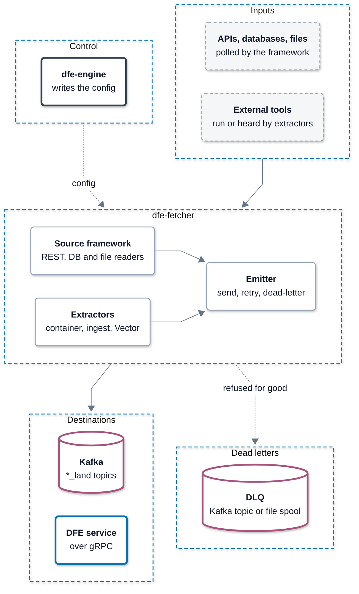
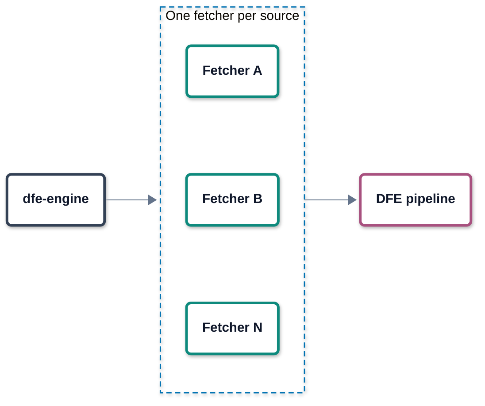

# dfe-fetcher architecture

dfe-fetcher pulls records from cloud and SaaS APIs, databases and files, and takes what external tools hand it. It is DFE's second way in beside dfe-receiver, and every record leaves on the same path into the pipeline.

*Figure 1. L3 Components -- dfe-fetcher. Dashed boxes are outside DFE, and dotted arrows are config and dead letters.* Up: [L2 Services -- DFE deployment](https://github.com/hyperi-io/dfe-infra/blob/main/docs/architecture.md). Down: [L4 Detail -- Source framework](internals.md), [L4 Detail -- Extractors](extractors.md), [L4 Detail -- Emitter](delivery.md).

## How data flows

1. dfe-engine writes the fetcher's config when an operator adds a source. On Kubernetes that is a deployment per source.
2. The **Source framework** ticks each connection on its interval. A reader pulls one window of events, a whole store as a dump, or messages off a queue.
3. The **Extractors** run alongside it. A container's stdout, a post to the ingest endpoint and a Vector push each arrive as records with no tick behind them.
4. Each record is stamped with its source, org and timestamps and batched. The **Emitter** sends every batch.
5. A record lands on Kafka, or goes straight to a DFE service over gRPC. One the transport refuses for good goes to the dead letters.
6. Once the transport has taken a batch, the source framework commits its cursor. A tick that fails commits nothing and fetches again.

## Components

| Part | Role | Page |
|---|---|---|
| Source framework | Schedules each connection, runs its reader and holds its cursor | [internals.md](internals.md) |
| Extractors | Runs external tools and listens for their records | [extractors.md](extractors.md) |
| Emitter | Sends every batch, retries backpressure and dead-letters refused records | [delivery.md](delivery.md) |

A reader is one of three types: `RestShape` for a REST profile, `DbShape` for a database and `FileShape` for files. A REST provider is a YAML profile, so adding one needs no Rust. The profile grammar is in [reference/profile-grammar.md](reference/profile-grammar.md).

## External dependencies

| Dependency | Needed for | Swappable |
|---|---|---|
| Kafka | The default transport and, on Kubernetes, the dead-letter topic `dfe_fetcher_dlq` | Any broker the `kafka.brokers` list reaches. `output.type: grpc` drops it from the data path |
| A DFE service over gRPC | `output.type: grpc` or `both`, and route destinations | dfe-loader, a transform or the archiver, by endpoint |
| Persistent volume | The cursor store, 1 GiB at `/var/lib/dfe-fetcher` | Any storage class. Without it every restart starts cold |
| Secrets manager | Provider credentials, as `vault:<mount>/<path>:<key>` specs | OpenBao or Vault, an env var, a file or a literal. `aws:` specs are refused |
| Docker or podman | Container extractors | Either runtime |
| ODBC drivers | `sources.db` with the `odbc` engine | The image has the PostgreSQL, MariaDB and SQLite drivers ([reference/db-drivers.md](reference/db-drivers.md)) |

The providers themselves are external too: each needs network egress from the pod and a credential the operator supplies. [cloud-setup/README.md](cloud-setup/README.md) covers each one.

## Deployment variants

| Variant | What runs |
|---|---|
| Kubernetes, `slim`, `single`, `scale`, `mesh` | No fetcher until a source is written. Then dfe-engine writes one deployment per source, each with its own config, `instance_id` and credentials |
| Docker `single` | One fetcher starts idle and holds every source in one config file |
| Docker `slim` | No fetcher |

On Kubernetes each fetcher's `instance_id` is bound to its source, and starts every cursor key it writes.

*Figure 2. L3 Components -- Fetcher deployments on Kubernetes.* Up: [L3 Components -- dfe-fetcher](architecture.md).

KEDA never scales a fetcher. It polls its upstreams rather than draining a queue, so a second replica would fetch the same windows twice. Several accounts of one provider can share a fetcher through a `connections` list or several `sources.rest` instances.

The release image has every database engine, the file tailer and jemalloc. A source build without the `db-*` or `file-tail` features refuses a config naming the missing engine at load, and says which feature to build.

## Design considerations

**Security.** Every provider connection is outbound. The ingest endpoint (8080) and the Vector receiver (6000) ship off. An enabled ingest listener with no `auth_token` will not start unless `ingest.allow_unauthenticated` is set, because `/ingest/{source}/{topic}` takes its topic from the URL.

**Reliability.** A cursor or queue ack is written once the transport has taken the batch, never before. A failed tick fetches again, so delivery is at least once and a replay can duplicate. A container's stdout is best effort, because a pipe can't be read twice.

**Operations.** The config file reloads on SIGHUP, a file change or a timer, and a reload that fails validation is refused. On Kubernetes the chart rolls the pod for most config edits. [reference/configuration.md](reference/configuration.md) has the cascade and what reloads. Metrics and health answer on 9090 (`/metrics`, `/livez`, `/readyz`).

**Performance.** A provider's API sets the pace, so the fetcher spends most of its time waiting on remote calls. It doesn't follow the zero-allocation hot-path rules of the loader and receiver. When memory pressure crosses `self_regulation.pause_above`, it stops polling for at most `max_hold_secs` and lets the provider hold the backlog.

## Why it's built this way

**Profiles, not per-provider code.** 21 providers ship as YAML profiles over one REST reader. A quirk the grammar can't express is a hook on one of its axes, written once for every provider that needs it.

**Parse the framing, not the content.** The fetcher turns NDJSON lines, JSON arrays, CSV rows and API envelopes into one JSON record per row. Parsing a long text field with grok or dissect is the transforms' job. The fetcher keeps no raw copy of what it fetched.

**Checkpoint after the ack.** Fetching a record twice is cheaper than losing it. Nothing downstream can recover a record that was never sent.

**A dump is a snapshot.** A table dumped whole travels as `begin`, rows and `end` under one `snapshot_id`, so a consumer can tell a complete copy from a cut-short one.

**Extractors for everything else.** A mature tool in another language, or a source Vector already reads, runs beside the fetcher instead of being rewritten in Rust. [extractors.md](extractors.md#profile-container-or-vector) says which mode fits a source.

## Diagram map

- [Figure 1. L3 Components -- dfe-fetcher](architecture.md)
  - [Figure 2. L3 Components -- Fetcher deployments on Kubernetes](#deployment-variants)
  - [L4 Detail -- Source framework](internals.md)
    - [L4 Detail -- One tick](internals.md#how-it-works)
  - [L4 Detail -- Extractors](extractors.md)
    - [L4 Detail -- Container extractor lifecycle](extractors.md#how-it-works)
    - [L4 Detail -- Choosing a mode for a source](extractors.md#profile-container-or-vector)
  - [L4 Detail -- Emitter](delivery.md)
  - [L4 Detail -- Configuration cascade](reference/configuration.md)
  - [L4 Detail -- Workspace crates](../CONTRIBUTING.md#where-things-live)

## What's next

- [config.example.yaml](../config.example.yaml), the annotated config, and [config-schema.yaml](config-schema.yaml), every key
- [cloud-setup/README.md](cloud-setup/README.md), one setup guide per provider
- [reference/](reference/README.md), the profile grammar, the snapshot envelope, the database drivers and the configuration cascade
- [CONTRIBUTING.md Context](../CONTRIBUTING.md#context), the workspace crates, their rules and the commands that test a change
