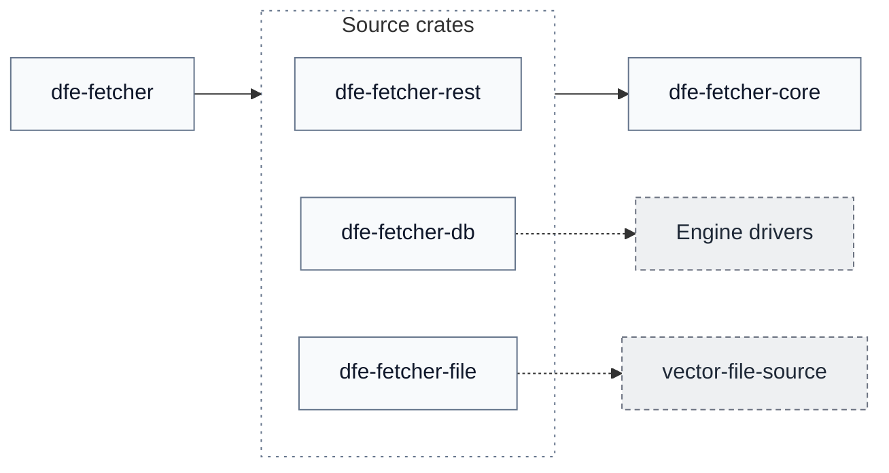

# dfe-fetcher architecture

The repo is a Cargo workspace: one app crate and a source framework split into
an I/O-free core plus one leaf crate per source family, with Vector's file
tailer copied in under `third-party/`. Every crate is `publish = false` and
inherits its version from `[workspace.package]`, so a release bump touches the
root manifest alone. This file is the codemap, the invariants, the crate graph
and the build graph. The runtime diagrams (the source framework, a tick, the
configuration cascade) are in [internals.md](internals.md).

## Codemap

| Where | What lives there |
|---|---|
| `crates/core` (`dfe-fetcher-core`) | The row model (`Row`, `Mark`, `RowSource`, `UnitSpec`, `TickCtx`), the batcher, the compiled per-row rules (CEL filter, routes, added fields), the snapshot envelope and its reassembler, the checkpoint contract (`CursorStore`, `CursorValue`, mark folding), the once-resolved secret cell (the resolver is the I/O crate's), the framework's error type and the list of metric names. No HTTP, no transport, no filesystem. |
| `crates/rest` (`dfe-fetcher-rest`) | The declarative REST profile grammar and its validation, `{{ cel }}` templates, the runtime axes (auth modes, pagers, streaming decoders, the request executor with retry and its per-unit origin gate), the hooks (row builders and the S3 lister), the queue unit kind, and `RestShape`, the `RowSource` for a bound profile. |
| `crates/db` (`dfe-fetcher-db`) | The `Store` contract (dump, keyset tail), the `sources.db` grammar, `DbShape` (the `RowSource` over an instance's stores), the per-dialect keyset predicate, the blocking-cursor pump and the block-to-row framing that leases every buffered block. Engines are features: `odbc` (unixODBC + `arrow-odbc` typing + `arrow-json` writing), `clickhouse` (server-side `JSONEachRow`, `dfe-clickhouse` for the ping and typed exceptions) and `mongodb` (the official driver: `find` to dump, change stream or `_id` to tail). |
| `crates/file` (`dfe-fetcher-file`) | The `FileSource` contract, the `sources.file` grammar, the dump reader (NDJSON, JSON array, CSV, gzip by magic) and the tail spec. The tailer sits behind the `tail` feature, over the copy of Vector's tailer in `third-party/`. |
| `third-party/vector-file-source{,-common}` | Vector's file tailer (MIT), copied from Vector's repository, and `crates/file` is the one crate that depends on it, by path. Provenance in `third-party/README.md`. |
| `crates/fetcher` (`dfe-fetcher`, the binary) | The config cascade and hot reload, the typed source blocks, their registry and their mapping onto profile instances (`crates/fetcher/src/config/builtin.rs`), the scheduler, `Driver` (the tick the scheduler runs for every framework source), the emitter, the pipeline (enrichment, DLQ, readiness), the output transports, the cursor file store, the shipped REST profiles (`profiles/*.yaml`), the deployment contract and capability catalog, the ingest server and the container and Vector extractors. |
| `config.example.yaml`, `docs/` | Operator-facing surface, at the repo root. The app crate's tests reach them through the manifest directory. |

Adding a REST source is a profile (YAML) plus an instance in `sources.rest`.
Adding a hook is a variant on an axis enum in `crates/rest`. Adding an engine is
a feature-gated module in `crates/db`. A typed source block (`sources.github`,
`sources.aws`) keeps its struct for the operator and maps onto an instance of
the shipped profile of the same name at load. The driver runs it like any
`sources.rest` entry.

## Negative invariants

- `dfe-fetcher-core` depends on no other workspace crate, and on scalo for nothing but
  `expression` and `rules`. It never names an HTTP client, a transport or a
  file. Async appears as nothing but `futures-core` stream and future types and the
  `async-trait` checkpoint store. tokio is linked for its clock types and its
  once-cell and never spawns a task there.
- `dfe-fetcher-rest`, `dfe-fetcher-db` and `dfe-fetcher-file` depend on `core`
  and never on each other or on the app. None sends to a transport, writes a
  cursor or reads the config cascade. Each receives bound units and yields rows.
- The app never re-implements a source, a pager, a decoder or an auth mode. It
  owns wiring, transports, checkpoint persistence, config and the deployment
  contract. There is no per-provider Rust in the app: a provider is a profile,
  and what a profile cannot say is a hook on an axis in `crates/rest`.
- No crate depends on a Vector crate from a registry. The file tailer is the
  copy of Vector's under `third-party/`, depended on path-only by
  `dfe-fetcher-file`.
- Nothing deployment-specific: no hostnames, addresses, vault paths or licence
  detail outside `config.example.yaml` placeholders and tests.

## Crate and build graph

The repo is a Cargo workspace laid out as a wide DAG off one I/O-free core, so
the source crates compile in parallel and a profile change never rebuilds a
database driver. What each crate holds is in the [codemap](#codemap).

This diagram shows which workspace crate depends on which.

*Figure 1. L4 Detail -- Workspace crates. Dashed boxes are not ours, and dotted arrows are behind a cargo feature.* Up: [dfe-fetcher documentation](README.md).

The app depends on `dfe-fetcher-core` directly as well. The engine drivers are unixODBC with `arrow-odbc`, `dfe-clickhouse` and the `mongodb` driver, behind `db-odbc`, `db-clickhouse` and `db-mongodb`. The tailer is Vector's (MIT), copied under `third-party/` and behind `file-tail`.

The app links all four crates unconditionally, so a `sources.db` or
`sources.file` block is always understood and validated. What the features
decide is whether the ENGINE behind an accepted config is present, which is
why naming an engine this binary lacks is a load error rather than a parse
error.

`core` is the root, on serde, bytes, chrono, uuid, smallvec, csv-core, cel and
scalo's `expression` and `rules`. `rest` (reqwest, async-compression,
backon, reqsign), `db` and `file` are siblings off `core` and compile in
parallel, and the app links all four. The shipped profiles live in the app
(`include_str!` in `crates/fetcher/src/profiles/mod.rs`), so editing one
rebuilds the app alone. A pager or hook change rebuilds `rest` and the app, and
an engine bump rebuilds `db` and the app. `db` is always linked for its grammar,
so a `sources.db` block naming an engine the binary lacks is refused at load
with the feature to build. The engines themselves and the file tailer are off
the default build.

The database and tailer features on the app follow scalo's
`<capability>-<backend>` naming: `db-odbc`, `db-clickhouse`, `db-mongodb` and
`file-tail`. Beside them are `file` (kept as a name, the dump is always built),
`jemalloc`, `full` and `pgo-driver`, which builds the PGO workload binary.
`.hyperi-ci.yaml` lists feature sets explicitly so a runner is never asked for a
native driver it does not have, and `db-odbc` needs unixODBC on the host. The
release build turns on `jemalloc` and all four engine and tailer features, and
its image has unixODBC and the open-licence drivers
([reference/db-drivers.md](reference/db-drivers.md)).

## Performance sensitivity

> **dfe-fetcher is less hot-path-sensitive than the rest of the DFE stack.**

A provider's API paces what a REST source hands over, so a fetcher mostly
waits on remote calls. Database dumps, files and extractors can move more, and
none has a benchmark against the loader, receiver, transform or archiver.

| Concern | Rest of DFE stack | dfe-fetcher |
|---|---|---|
| Per-record allocation | Zero-allocation hot path. Pre-allocated pools, arenas | Allocate freely - `Vec`, `String`, `serde_json::Value` are fine |
| SIMD JSON parse | `sonic-rs` mandatory on hot paths | `serde_json` is sufficient |
| Cloning / `Bytes` reuse | Aggressive `Bytes` reuse, `Cow`, arena lifetimes | One allocation per enveloped row is fine |
| Channel sizing | Backpressure-tuned bounded channels per stage | The batcher's bounds and the memory guard's lease are the backpressure |
| `regex` on hot path | Forbidden - use `memchr` / `memmem::Finder` | Acceptable if needed. Volumes don't justify rewrite |
| `async fn` granularity | Watch `.await` budget, yield_now hints | `await` per HTTP request is the unit of work. One virtual `poll_next` per row through a boxed stream |
| Per-source concurrency | Lock-free, sharded, ArcSwap | A mutex around a token cache is acceptable |

We still care about correctness, cancellation safety, bounded retries
and not leaking tasks. We prefer the simple, idiomatic version of any
pattern over the clever one. But the aggressive hot-path discipline
applied across dfe-loader / dfe-receiver / dfe-archiver does **not** need to be
applied symmetrically here.

Measure a source before changing the driver's allocation or streaming. The two shortcuts the driver takes on purpose -- fetch and emit do not
overlap, and the row stream is boxed -- are marked where they sit in
`crates/fetcher/src/driver.rs` with the measurement that would lift them.
When a fetcher source ever becomes a bottleneck (sustained high-cardinality
tenants, very chatty audit feeds), revisit on a case-by-case basis - the
scalo hot-path patterns are available if needed, just not the default
starting point here.
