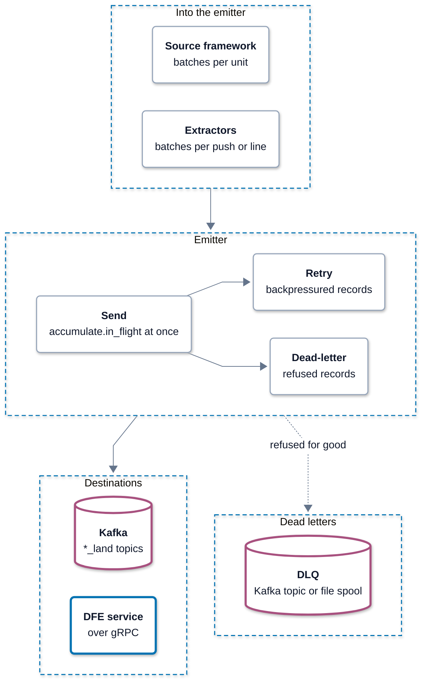

<!-- Project:   dfe-fetcher                                                -->
<!-- File:      docs/delivery.md                                           -->
<!-- Purpose:   The emitter: sends, dead letters, guarantees and stamps    -->
<!-- Language:  Markdown                                                   -->
<!--                                                                       -->
<!-- License:   BUSL-1.1                                                   -->
<!-- Copyright: (c) 2026 HYPERI PTY LIMITED                                -->

# Emitter

The emitter is the one delivery path in [dfe-fetcher](architecture.md): every batch from the source framework and the extractors leaves through it.

| | |
|---|---|
| Repo | [hyperi-io/dfe-fetcher](https://github.com/hyperi-io/dfe-fetcher), `crates/fetcher/src/emit.rs` and `crates/fetcher/src/pipeline/` |
| Image and chart | `ghcr.io/hyperi-io/dfe-fetcher`, and the thin chart each release assembles from `crates/fetcher/src/deployment.rs` |
| Config reference | `output`, `kafka`, `accumulate` and `dlq` in [config.example.yaml](../config.example.yaml) |
| Endpoints | Outbound to Kafka, or to a gRPC endpoint such as `http://dfe-loader:6000` |
| Metrics | `pipeline_dead_letters_dropped_total`, `pipeline_delivery_guarantee`, `usage_ingested_bytes_total` on `:9090/metrics` |

The emitter batches nothing itself. The driver and the extractor sink build the batches and stamp each record first, through one shared enrichment step.

*Figure 1. L4 Detail -- Emitter. The dotted arrow is the dead-letter path.* Up: [L3 Components -- dfe-fetcher](architecture.md).

## How it works

1. A flush's records go out as concurrent sends, `accumulate.in_flight` at a time.
2. Every record ends sent, dead-lettered or backpressured.
3. The backpressured ones are held and sent again, the wait doubling from 200 ms to 5 s, until the output takes them or the fetcher shuts down. The batch keeps its memory lease meanwhile, so the memory brake stops new fetches. After the shutdown signal a held batch is still sent for up to 6 s, because an intake record has no upstream copy. Then the tick ends with no checkpoint and the rows are fetched again on restart.
4. A record the transport refuses, and would refuse again, goes to the DLQ with its payload cut at `dlq.max_payload_bytes`.

A failure every record shares (the transport closed or timed out, the broker gone) is not a dead letter. The tick aborts and the rows are fetched again. That is the at-least-once side of the contract.

A flush that settles adds each sent record's fetched length to `usage_ingested_bytes_total{org_id}`. A dead-lettered or dropped record isn't counted, and neither is any record of a flush that aborts, because the fetch sends it again.

## Interfaces

`output.type` picks `kafka`, `grpc` or `both`. `output.destinations` names other places a record can go, and `output.routes` sends matching records there. A route to one destination stamps that name as `_source`, so the record lands in that source's table. A fan-out keeps the fetching source's `_source`.

Every record leaves with five reserved fields:

| Field | Value |
|---|---|
| `_timestamp_fetcher`, `_timestamp_received` | When the fetcher took the record |
| `_source` | The topic base, or the destination a single-destination route names |
| `_source_fetcher` | `<connection>.<unit>` |
| `_org_id` | `org_id`, else `default_org_id` |

The per-source [CEL](https://github.com/cel-expr/cel-spec/blob/master/doc/langdef.md) filter runs before these are added, so it can't reference them. A payload that has one keeps its value under `<key>_original`, and the fetcher's value takes the name. The loader routes on `_source` and a record's org is its `_org_id`, so the fetcher's values must be the ones that survive. `<key>_original` is never overwritten: a second collision goes to `<key>_original_<n>`, counting from 2.

A JSON array of objects goes out as one record per element, each stamped, because the loader splits arrays and an unstamped element would land in the default org. A body of several whitespace-separated objects is split the same way. `[]` goes out as nothing.

A payload that opens as a JSON object and can't be stamped is refused, because sent as it came it would keep any `_org_id` its sender gave it. A binary row, a scalar or plain text goes out verbatim with no `_org_id`. The loader rejects it, and the archiver may keep it.

## Scaling and failure

A dead letter counts once the DLQ confirms a backend holds it: on disk for the file backend, acked by the broker for Kafka. A DLQ write that is rejected or unconfirmed aborts the tick like a transport failure, so the checkpoint never passes a record nothing holds. On Kubernetes the chart sets `dlq.mode: kafka_only`, so dead letters go to the `dfe_fetcher_dlq` topic.

An enabled DLQ with no backend that starts logs an ERROR at startup and rejects every dead-letter write, so a refused record is fetched again. A DLQ config that doesn't parse fails startup.

With no DLQ, a refused record is dropped and counted in `pipeline_dead_letters_dropped_total{reason}`: `transport_refused`, `too_large` for an oversize row and `unstampable` for a row enrichment refused. Fetching it again would hold the source back for nothing. A dead letter too big for any DLQ backend is dropped the same way. The default `dlq.max_payload_bytes` cut keeps an entry under Kafka's `message.max.bytes`.

Each intake reports its guarantee in `pipeline_delivery_guarantee{listener,guarantee,reason}`. A scheduled source and the ingest listener hold their cursor or answer until delivery, so over Kafka or gRPC they are `at_least_once`. A container's stdout is `best_effort`.

## Key metrics

| Metric | Healthy when |
|---|---|
| `pipeline_dead_letters_dropped_total{reason}` | Flat. Any rise is records lost with no DLQ |
| `pipeline_delivery_guarantee{listener,guarantee}` | `at_least_once` on every scheduled source |
| `dfe_fetcher_transport_send_duration_seconds` | Steady. A climb is the transport pushing back |
| `dfe_transport_healthy` | 1. It reads 0 while any default output is down, and the scheduler fetches nothing until it is back |
| `dfe_transport_backpressured_total` | Flat. A steady climb is a batch held for an output that keeps refusing it |
| `usage_ingested_bytes_total{org_id}` | Tracks what the providers hand over |

## Related

- [Source framework](internals.md), where batches come from and when cursors commit
- [Extractors](extractors.md), what each extractor guarantees its sender
- [reference/snapshot-envelope.md](reference/snapshot-envelope.md), how a dump is framed
