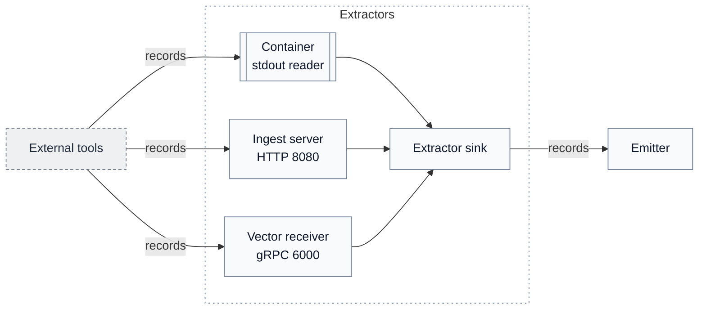
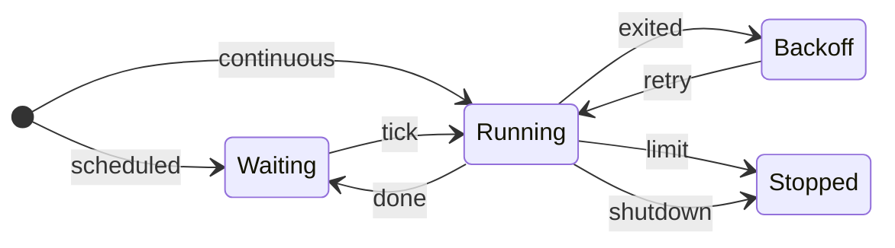
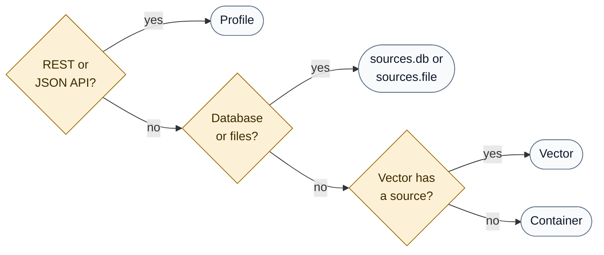

<!-- Project:   dfe-fetcher                                                              -->
<!-- File:      docs/extractors.md                                                       -->
<!-- Purpose:   Container and Vector extractors: lifecycle, communication and guarantees -->
<!-- Language:  Markdown                                                                 -->
<!--                                                                                     -->
<!-- License:   BUSL-1.1                                                                 -->
<!-- Copyright: (c) 2026 HYPERI PTY LIMITED                                              -->

# Extractors

Beside the source framework the fetcher runs external tools: a container whose stdout JSON lines or HTTP posts it collects, and Vector, whose native gRPC protocol it receives. Neither runs a tick or keeps a checkpoint: an extractor's records go through the same enrichment and emit path as a source's ([delivery.md](delivery.md)), and its guarantee is its own, below.

This diagram shows the three ways an external tool's records reach the fetcher.

*Figure 1. L4 Detail -- Extractors. The dashed box is external.* Up: [L3 Components -- dfe-fetcher](../README.md#architecture). Down: [L4 Detail -- Container extractor lifecycle](#container-extractor-lifecycle).

A container extractor runs its tool in Docker or podman and reads JSON lines from its stdout. A container can instead post JSON to the ingest server, and Vector, in a container or a sidecar, pushes over Vector's gRPC protocol. The ingest server and the Vector receiver are off until a deployment enables them.

## Container Extractor Lifecycle

This diagram shows the states of one container extractor.

*Figure 2. L4 Detail -- Container extractor lifecycle. Shutdown stops a waiting or backing-off extractor the same way.* Up: [L4 Detail -- Extractors](#extractors).

A continuous extractor that exits is restarted after a backoff that doubles up
to 64 s, or up to `max_restart_backoff_secs` when that is lower, so a setting
above 64 changes nothing. The backoff resets once a run has stayed
up for `stable_after_secs`. A container that exits more than
`max_restart_attempts` times with no stable run between stops for good (0, the
default, restarts it for ever). No health check runs while a container is up:
an extractor is judged by its container's exit.

## Container Communication

The HTTP mode listener needs `ingest.auth_token`: every `/ingest` call has `Authorization: Bearer <token>`. With no token the listener refuses to start unless `ingest.allow_unauthenticated: true` is set. The `/livez` and `/readyz` probes are exempt.

The stdout reader and the ingest server hand each line or body to the extractor sink as it came, and the Vector receiver converts a push's events to JSON first. The sink enriches them as [delivery.md](delivery.md) describes.

What each mode guarantees:

- Vector: the receiver is built armed, so with `extractors.vector.acknowledgements.enabled` (the default) a push is answered only after its events are emitted: `OK` once the outputs took them or the DLQ confirmed them, `UNAVAILABLE` otherwise, which Vector's sink retries. A push still unanswered near its hold budget (25 s, less when Vector sets a deadline) is answered `UNAVAILABLE` as well, so a slow output can duplicate but not lose. Disabled, a push is answered once queued and a crash loses it. While the fetcher's memory-pressure latch holds, a push is refused `UNAVAILABLE` before any work.
- HTTP: with `ingest.acknowledgements.enabled` (the default), `/ingest` answers `200` only after the outputs took the record or the DLQ confirmed it, and `503` otherwise, with `Retry-After` when the outputs pushed back. Disabled, a ready pipeline answers `200` at once and delivers the record after, so a failed delivery or a crash loses it. Such a loss counts in `dfe_fetcher_extractor_records_failed_total{extractor="ingest",outcome="dropped"}`.
- stdout: a pipe cannot be read twice, so a line the outputs cannot take yet is held and retried, pausing from 1 s up to 30 s, and the container's stdout is not read meanwhile, so the container blocks on its writes until the outputs recover. Only a failure no retry can clear (no output configured), or a line still held at shutdown after one more attempt, is dropped, counted in `dfe_fetcher_extractor_records_failed_total{extractor="container",outcome="dropped"}` and never in the received count.

## Shutdown and the Vector listeners

At shutdown the extractors deliver what they hold before the outputs close, for up to 20 s: the Vector receiver refuses new pushes and delivers what it has queued, and a container extractor stops its container while still reading its stdout to the end. A scheduled container's `timeout_secs` bounds the whole run, stdout included: at the timeout the container is killed and the run fails. A line held for an output outage is not interrupted by the timeout. The kill follows once the line is delivered.

A Vector listener that cannot bind at start-up fails the process: it drains, stops its containers and exits non-zero, so the pod restarts rather than stay Ready with a dead intake.

A Vector push names no instance, so the listener it arrives on decides its topic. The shared `extractors.vector.grpc_bind_address`, the one port the chart publishes, has at most one instance and lands on that instance's `topic`, or on `vector` when none shares it. Every other instance names its own `grpc_bind_address` and lands on that `topic`. Two instances sharing the listener are refused at load.

## Profile, container or Vector

This diagram shows which mode a source takes.

*Figure 3. L4 Detail -- Choosing a mode for a source.* Up: [L3 Components -- dfe-fetcher](../README.md#architecture).

A profile that needs a signer, a lister, a row builder or a paging quirk adds a hook on the matching axis in `crates/rest` and stays a profile.

| Criterion | REST profile | Container | Vector |
|-----------|--------------|-----------|--------|
| A plain REST or JSON API | Yes | - | - |
| A mature tool in another language does the job | - | Yes | - |
| Vector has a native source for it | - | - | Yes |
| Needs process isolation from the fetcher | - | Yes | - |
| Third-party maintained | - | Yes | Yes |
| Wanted: checkpoint after ack, the snapshot envelope, the memory brake | Yes | - | - |

Sources the fetcher pulls, and the mode each takes:

| Source | Mode | Reason |
|--------|------|--------|
| AWS CloudTrail | Profile | JSON API signed with the `sigv4` auth mode |
| Azure Activity Log | Profile | REST API paged by `nextLink` |
| M365 Audit Log | Profile | A prelude, a paged content list and a manifest per blob |
| runZero inventory | Profile | NDJSON exports as snapshot dumps |
| An inventory database | `sources.db` | A table dumped whole or tailed by key |
| Prometheus exporters | Container | A mature exporter run as a sidecar |
| Syslog collection | Vector | Vector has a native syslog source |

For log sources that established tools handle well, use container extractors
with a collection agent that can print JSON lines or POST JSON, such as Vector
or Fluent Bit. Filebeat has no HTTP output ([its outputs](https://www.elastic.co/docs/reference/beats/filebeat/configuring-output) are Elastic Cloud, Elasticsearch, Logstash, Kafka, Redis, file, console and discard), so ship Beats data to dfe-receiver's Lumberjack listener instead.

| Source Type | Sidecar Tool | Communication |
|-------------|-------------|---------------|
| Syslog | Vector or Fluent Bit | HTTP POST to `/ingest/syslog` |
| Windows Event Logs | A forwarder that POSTs JSON (winlogbeat is a separate Beat with the same output limits) | HTTP POST to `/ingest/windows_events` |
| Custom app logs | A shipper that prints JSON lines | stdout JSON lines |
| Network captures | Zeek / Suricata | stdout JSON lines |
| Cloud provider logs | Cloud-specific CLI tools | stdout JSON lines |

Each sidecar runs as a container extractor with `mode: continuous` and
communicates via stdout (JSON lines) or HTTP POST to the ingest endpoint.
The fetcher manages the container lifecycle including restart-on-crash with
exponential backoff. A log file the fetcher itself can reach is a
`sources.file` tail unit instead.
