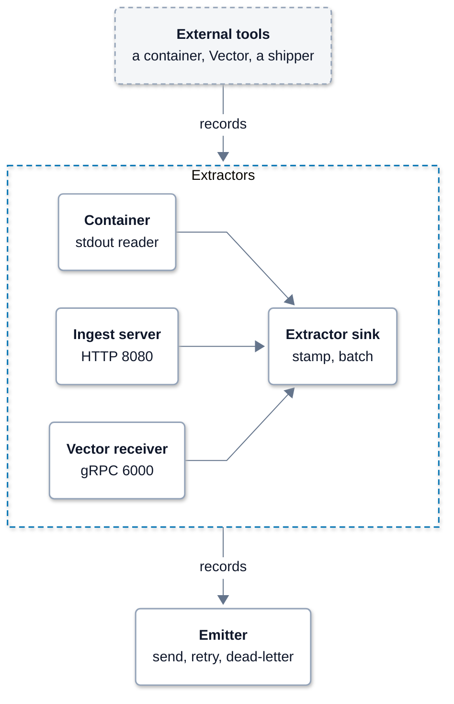
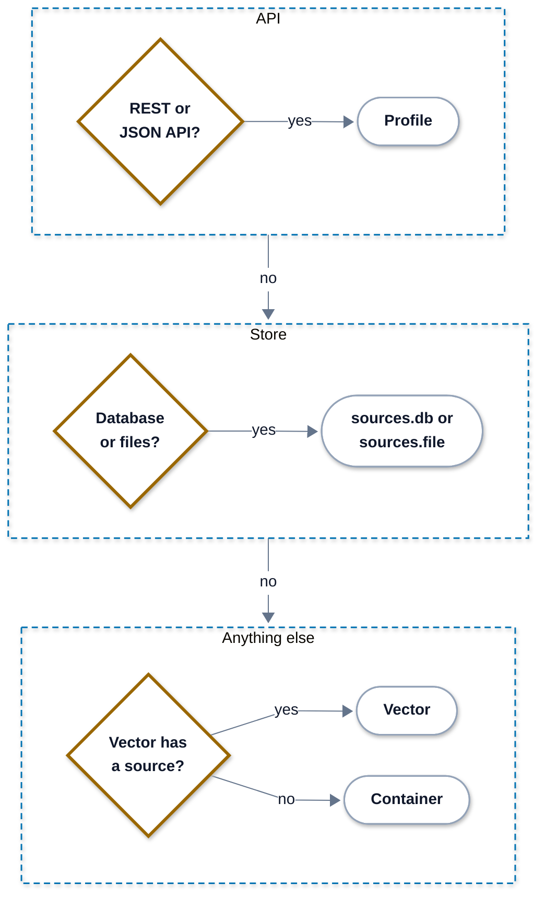

<!-- Project:   dfe-fetcher                                                              -->
<!-- File:      docs/extractors.md                                                       -->
<!-- Purpose:   Container and Vector extractors: lifecycle, communication and guarantees -->
<!-- Language:  Markdown                                                                 -->
<!--                                                                                     -->
<!-- License:   BUSL-1.1                                                                 -->
<!-- Copyright: (c) 2026 HYPERI PTY LIMITED                                              -->

# Extractors

The extractors are the part of [dfe-fetcher](architecture.md) that runs external tools and takes their records, with no tick and no checkpoint behind them.

| | |
|---|---|
| Repo | [hyperi-io/dfe-fetcher](https://github.com/hyperi-io/dfe-fetcher), `crates/fetcher/src/extractor/` and `crates/fetcher/src/ingest/` |
| Image and chart | `ghcr.io/hyperi-io/dfe-fetcher`, and the thin chart each release assembles from `crates/fetcher/src/deployment.rs` |
| Config reference | `extractors` and `ingest` in [config.example.yaml](../config.example.yaml). Every change needs a restart |
| Endpoints | Ingest HTTP on 8080 (`POST /ingest/{source}`, `POST /ingest/{source}/{topic}`), Vector gRPC on 6000. Both ship off |
| Metrics | `dfe_fetcher_extractor_*` and `dfe_fetcher_ingest_*` on `:9090/metrics` |

A container can reach the fetcher two ways: printing JSON lines to stdout, or posting JSON to the ingest server. Vector runs in a container or as a sidecar and pushes over its native gRPC protocol.

*Figure 1. L4 Detail -- Extractors. The dashed box is outside DFE.* Up: [L3 Components -- dfe-fetcher](architecture.md). Down: [L4 Detail -- Container extractor lifecycle](#how-it-works).

## How it works

A container extractor runs its tool in Docker or podman. A scheduled one runs every `interval_secs` and waits between runs. A continuous one starts at once and is restarted after it exits.

```mermaid
---
config:
  theme: base
  fontFamily: Inter, -apple-system, Segoe UI, Roboto, Helvetica, Arial, sans-serif
  themeVariables:
    fontSize: 15px
    lineColor: "#64748B"
    primaryTextColor: "#0F172A"
    actorBkg: "#FFFFFF"
    actorBorder: "#94A3B8"
    actorTextColor: "#0F172A"
    actorLineColor: "#64748B"
    signalColor: "#64748B"
    signalTextColor: "#0F172A"
  themeCSS: >-
    .messageText{paint-order:stroke;stroke:#FFFFFF;stroke-width:3px;stroke-linejoin:round}
---
stateDiagram-v2
    direction LR
    accTitle: L4 Detail -- Container extractor lifecycle
    accDescr: A scheduled container waits an interval, runs, and waits again. A continuous container runs at once and, when it exits, waits out a backoff and runs again. It stops for good when it exits more than max_restart_attempts times with no stable run between. Shutdown stops it from any state.
    [*] --> Running: continuous
    [*] --> Waiting: scheduled
    Waiting --> Running: tick
    Running --> Waiting: done
    Running --> Backoff: exited
    Backoff --> Running: retry
    Running --> Stopped: limit
    Running --> Stopped: shutdown
    Waiting --> Stopped: shutdown
    Backoff --> Stopped: shutdown
```

*Figure 2. L4 Detail -- Container extractor lifecycle.* Up: [L4 Detail -- Extractors](extractors.md).

The backoff doubles up to 64 s, or up to `max_restart_backoff_secs` when that is lower. It resets once a run stays up for `stable_after_secs`. A container that exits more than `max_restart_attempts` times with no stable run between stops for good (0, the default, restarts it forever). No health check runs during a run: an extractor is judged by its container's exit.

The stdout reader and the ingest server hand each line or body to the sink as it came. The Vector receiver converts a push's events to JSON first. The sink stamps them as the [Emitter](delivery.md) page sets out.

## Interfaces

The ingest server needs `ingest.auth_token`, and every `/ingest` call carries `Authorization: Bearer <token>`. With no token it won't start unless `ingest.allow_unauthenticated: true` is set. `/livez` and `/readyz` are exempt. `/ingest/{source}/{topic}` takes its topic from the URL, so an open listener lets anything that reaches the port write to any topic.

The Vector receiver speaks cleartext gRPC, so a proxy in front of it must speak h2c. A Vector push names no instance, so the listener it arrives on decides its topic. The shared `extractors.vector.grpc_bind_address`, the one port the chart publishes, takes at most one instance and lands on its `topic`, or on `vector` when none shares it. Every other instance names a separate `grpc_bind_address`. Two instances sharing a listener are refused at load.

## Scaling and failure

What each mode guarantees its sender:

- Vector: With `extractors.vector.acknowledgements.enabled` (the default), a push is answered `OK` once the outputs took its events or the DLQ confirmed them, and `UNAVAILABLE` otherwise. Vector's sink retries. A push still unanswered near its 25 s hold budget is answered `UNAVAILABLE` too, so a slow output can duplicate but not lose. Disabled, a push is answered once queued and a crash loses it. Under memory pressure a push is refused `UNAVAILABLE` before any work.
- HTTP: With `ingest.acknowledgements.enabled` (the default), `/ingest` answers `200` once the outputs took the record or the DLQ confirmed it, and `503` otherwise, with `Retry-After` on backpressure. Disabled, it answers `200` at once and holds the record until the outputs take it. At most `accumulate.in_flight` records wait that way, and past that `/ingest` answers `503` with `Retry-After`. A crash, or a shutdown while the outputs still refuse it, loses the record.
- stdout: A pipe can't be read twice, so a line the outputs can't take is held and retried from 1 s up to 30 s. The container blocks on its writes meanwhile. A line with no output to go to, or still held at shutdown, is dropped and counted.

At shutdown the extractors deliver what they hold for up to 20 s before the outputs close. A scheduled container's `timeout_secs` bounds the whole run, stdout included. A Vector listener that can't bind at start-up fails the process, so the pod restarts rather than stay Ready with a dead intake.

## Profile, container or Vector

A REST or JSON API becomes a profile, a database or files a `sources.db` or `sources.file` block, and anything else an extractor.

*Figure 3. L4 Detail -- Choosing a mode for a source.* Up: [L4 Detail -- Extractors](extractors.md).

A profile that needs a signer, a lister, a row builder or a paging quirk adds a hook on the matching axis in `crates/rest` and stays a profile.

| Criterion | REST profile | Container | Vector |
|-----------|--------------|-----------|--------|
| A plain REST or JSON API | Yes | - | - |
| A mature tool in another language does the job | - | Yes | - |
| Vector has a native source for it | - | - | Yes |
| Needs process isolation from the fetcher | - | Yes | - |
| Third-party maintained | - | Yes | Yes |
| Wanted: checkpoint after ack, the snapshot envelope, the memory brake | Yes | - | - |

| Source | Mode | Reason |
|--------|------|--------|
| AWS CloudTrail | Profile | JSON API signed with the `sigv4` auth mode |
| Azure Activity Log | Profile | REST API paged by `nextLink` |
| M365 Audit Log | Profile | A prelude, a paged content list and a manifest per blob |
| runZero inventory | Profile | NDJSON exports as snapshot dumps |
| SAP S/4HANA entity set | Profile | OData V2 pages followed by `d.__next` |
| An inventory database | `sources.db` | A table dumped whole or tailed by key |
| Prometheus exporters | Container | A mature exporter run as a sidecar |
| Syslog collection | Vector | Vector has a native syslog source |
| Network captures | Container | Zeek or Suricata printing JSON lines |

A log file the fetcher can read is a `sources.file` tail unit, not a container. Filebeat has no HTTP output ([its outputs](https://www.elastic.co/docs/reference/beats/filebeat/configuring-output)), so Beats data goes to dfe-receiver's Lumberjack listener instead.

## Key metrics

| Metric | Healthy when |
|---|---|
| `dfe_fetcher_active_extractors` | Matches the extractors configured |
| `dfe_fetcher_extractor_runs_error_total` | Flat. A rise is a container exiting non-zero |
| `dfe_fetcher_extractor_restart_exhausted_total` | Zero. Any count is a container stopped for good |
| `dfe_fetcher_extractor_records_failed_total{extractor,outcome}` | No `dropped` outcomes |
| `dfe_fetcher_ingest_requests_total` | `503`s stay rare |

## Related

- [Emitter](delivery.md), where the sink's batches go
- [Source framework](internals.md), the scheduled path for APIs, databases and files
- [config.example.yaml](../config.example.yaml), every extractor and ingest key
