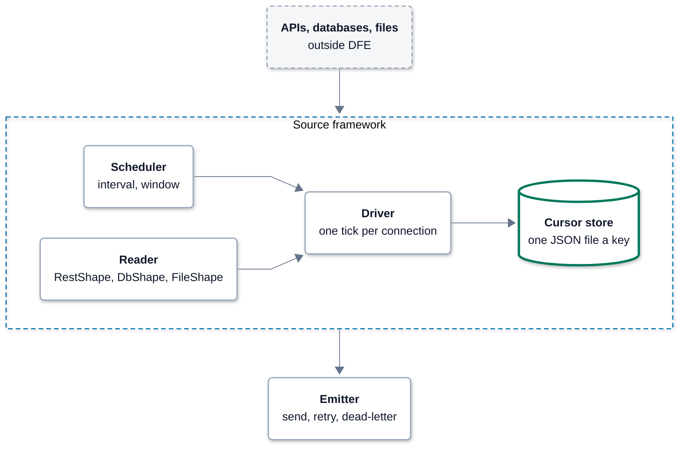
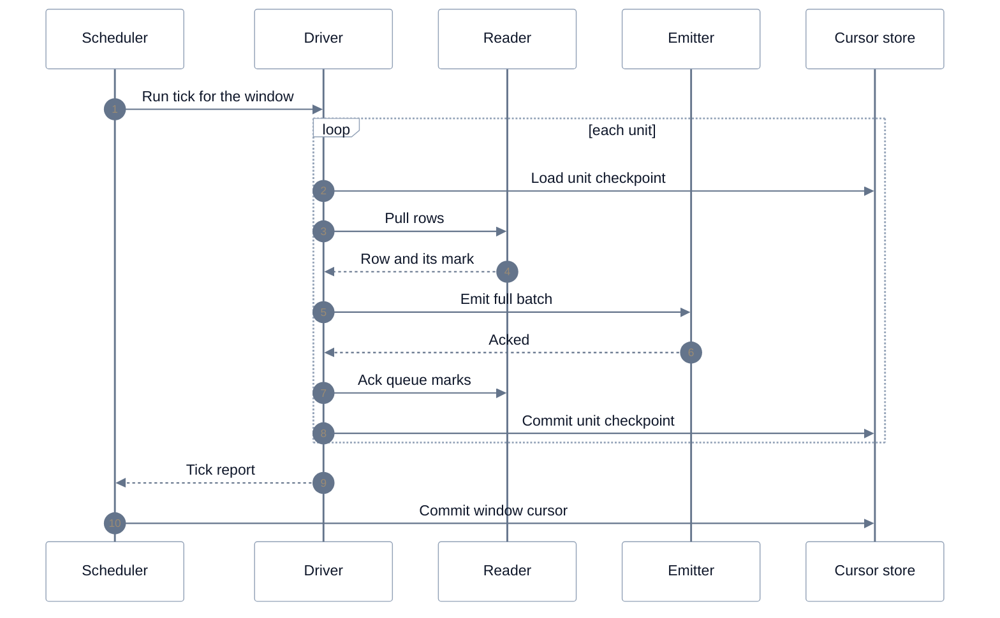

<!-- Project:   dfe-fetcher                          -->
<!-- File:      docs/internals.md                        -->
<!-- Purpose:   The source framework: readers, the tick and cursors -->
<!-- Language:  Markdown                               -->
<!--                                                   -->
<!-- License:   BUSL-1.1                               -->
<!-- Copyright: (c) 2026 HYPERI PTY LIMITED            -->

# Source framework

The source framework is the part of [dfe-fetcher](architecture.md) that polls APIs, databases and files on a schedule and keeps a cursor for each connection.

| | |
|---|---|
| Repo | [hyperi-io/dfe-fetcher](https://github.com/hyperi-io/dfe-fetcher), crates `core`, `rest`, `db`, `file` and the app's scheduler and driver |
| Image and chart | `ghcr.io/hyperi-io/dfe-fetcher`, and the thin chart each release assembles from `crates/fetcher/src/deployment.rs` |
| Config reference | `scheduler`, `sources.*`, `cursor` and `self_regulation` in [config.example.yaml](../config.example.yaml) |
| Endpoints | None inbound. Every connection is outbound to a provider |
| Metrics | `dfe_fetcher_*` on `:9090/metrics` |

A connection is one configured account of one source, and its reader type follows the source kind. Its cursor key is `<instance_id>.<connection id>`.

*Figure 1. L4 Detail -- Source framework. The dashed box is outside DFE.* Up: [L3 Components -- dfe-fetcher](architecture.md). Down: [L4 Detail -- One tick](#how-it-works).

## How it works

A tick runs for each connection once per interval, with `jitter_percent` of jitter.

*Figure 2. L4 Detail -- One tick. Solid arrows are requests and dashed arrows are answers.* Up: [L4 Detail -- Source framework](internals.md).

A unit is one endpoint, store, subscription or prefix. Its rows are the events inside the scheduler's window, or the whole store as a dump. The driver pulls them lazily.

Between pulling a row and batching it, the driver unwraps nested JSON, wraps a dump row in the snapshot envelope and stubs an oversize row. It then applies the per-source rules (CEL filter, routes, added fields). A batch goes to the emitter at `accumulate.max_rows`, `max_bytes` or `window_ms`, and the last one when the unit's rows end.

A row's mark is whatever lets the unit resume: a queue ack id, a manifest item, a key tuple or a file offset. The driver folds a batch's marks and commits them once the emitter reports the batch acknowledged. A queue message is acked to its broker once it is on the wire, never before.

A dump scoped per tick opens its snapshot before the first row, so an empty store lands as an empty snapshot. A directory dump opens a snapshot per file and closes it when the next file starts. A bad file leaves the files before it complete and committed.

## Interfaces

| Reader and unit | Checkpoint mark | Lands on |
|---|---|---|
| REST, incremental | The scheduler's window cursor. A manifest unit marks each item | `<topic>` |
| REST, dump | None | `<topic>-<unit>` |
| REST, queue | Ack id per row | `<topic>` |
| DB dump | None | `<topic>-<unit>` |
| DB tail | Key tuple per row, or the resume token on a MongoDB change stream | `<topic>` |
| File dump | Path and change time per file | `<topic>-<unit>` |
| File tail | Fingerprint and end offset per line | `<topic>` |

The topic suffix (`_land` by default) is appended to every topic. `topic_per_dump_unit: false` sends a dump to `<topic>` instead.

A REST profile describes an API with no identity, and an instance binds it to one deployment's credentials, `vars`, topic and interval. Every struct rejects unknown keys and every enum is closed, so a typo fails the load with its YAML line. The grammar is in [reference/profile-grammar.md](reference/profile-grammar.md).

A DB tail selects rows past the last committed key tuple, in key order. A file dump reads each matched file once (NDJSON, a JSON array or CSV, gzip by magic) and reads it again if it changes in place. A file tail follows growing files through rotation and truncation on Vector's file tailer, behind the `file-tail` feature. The engines and their drivers are in [reference/db-drivers.md](reference/db-drivers.md).

A dump's rows travel as a `begin` frame, a frame per row and an `end` frame with the row count, under one UUIDv7 `snapshot_id`. A consumer rebuilds the store by `snapshot_id`, and a dump with no `end` was cut short. The frames are in [reference/snapshot-envelope.md](reference/snapshot-envelope.md). A single-destination route moves a dump's matching rows to that destination's table but leaves `begin` and `end` behind, so neither table holds a dump that can be reassembled.

## Scaling and failure

`scheduler.max_concurrent_fetches` caps the ticks in flight across every connection. A fetcher never scales out, because two replicas would fetch the same windows.

When the memory guard crosses `self_regulation.pause_above`, a source stops polling and flushes what it holds, so the provider keeps the backlog. A hold lasts at most `self_regulation.max_hold_secs`, then the source polls on and logs a warning. Database engines stream in bounded blocks, each leased on the memory guard.

A DB tail reads pages of `limit` rows within one tick and stops at the first short page or at `max_pages_per_tick`. One query a tick would cap a table at `limit / interval` rows a second, and a faster table would fall behind with no signal.

A tick that fails commits nothing more and fetches again next time. A tick with no window cursor is a cold start. `cursor.on_missing_cursor: lookback` (the default) fetches the last `default_window_hours`, so a lost cursor skips anything older. `refuse` fetches nothing until a cursor exists, so a new source never starts unaided. A cursor read that fails is refused under either setting and tried again next tick. A unit checkpoint that can't be read logs `checkpoint read failed; starting the unit over` and the unit starts from empty.

A cursor directory with no volume behind it loses every cursor on a restart. The chart mounts a persistent 1 GiB volume for it.

## Key metrics

| Metric | Healthy when |
|---|---|
| `dfe_fetcher_fetches_total{source,status}` | Errors stay a small share of successes |
| `dfe_fetcher_cursor_age_seconds` | Stays near the source's interval |
| `dfe_fetcher_cursor_cold_start_total{source}` | Counts once per new source, never after a restart |
| `dfe_fetcher_fetch_pressure_ratio` | Below 1. At 1 every fetch slot is busy |
| `dfe_fetcher_tail_pages_full_total` | Rises rarely. A steady rise means a tail is falling behind |
| `dfe_fetcher_api_errors_total{source,code}` | Flat. A rise is a provider failing calls, by status class |

## Related

- [Emitter](delivery.md), where the driver's batches go
- [Configuration cascade](reference/configuration.md), how the config loads and what reloads
- [cloud-setup/README.md](cloud-setup/README.md), the credentials each provider needs
