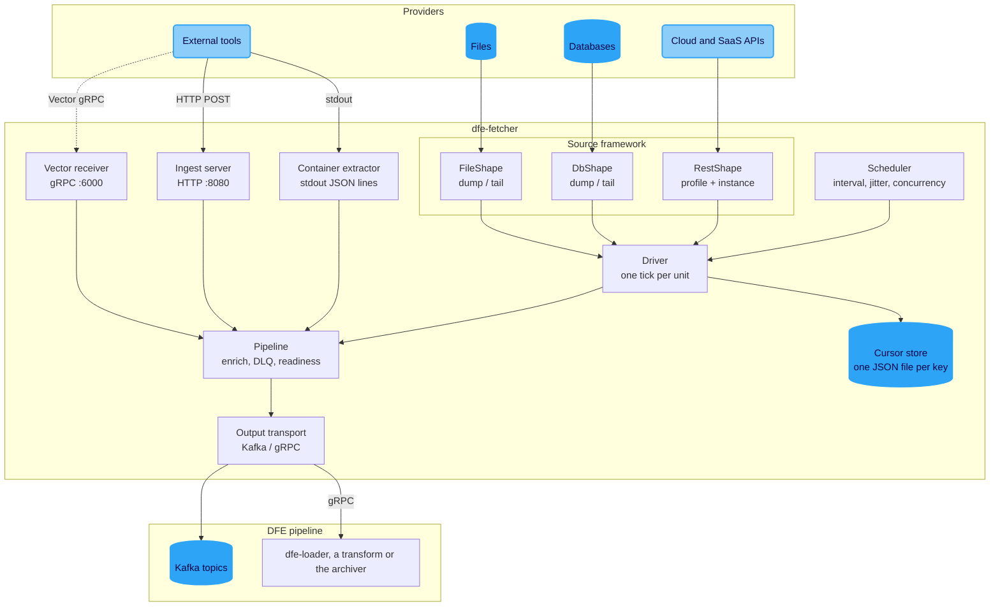
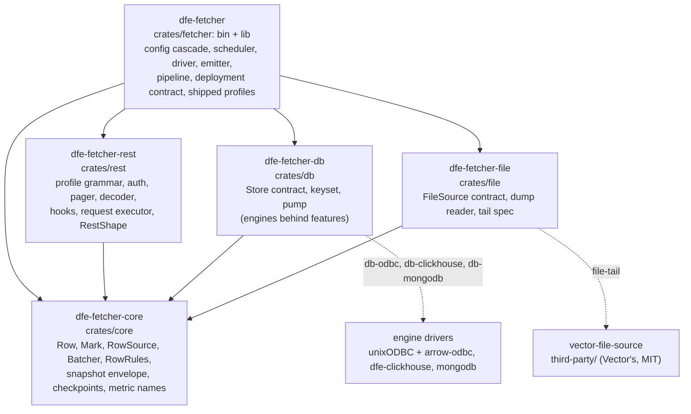
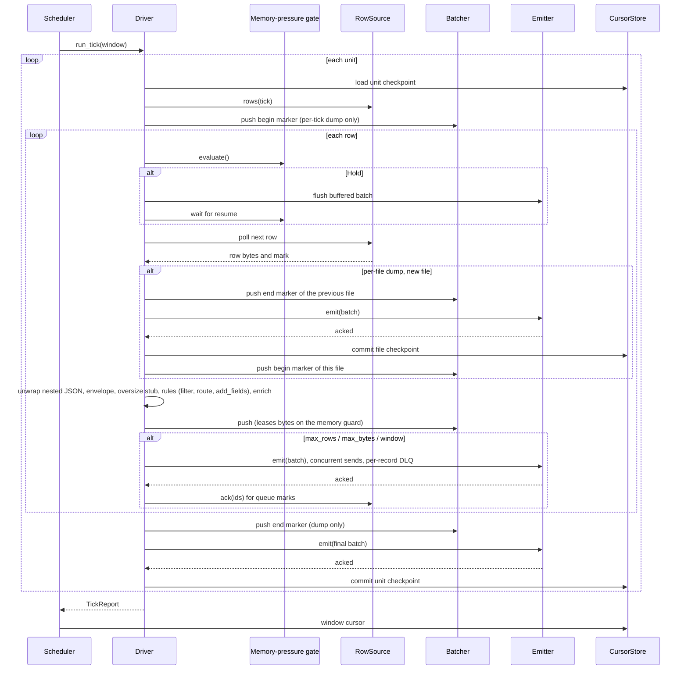
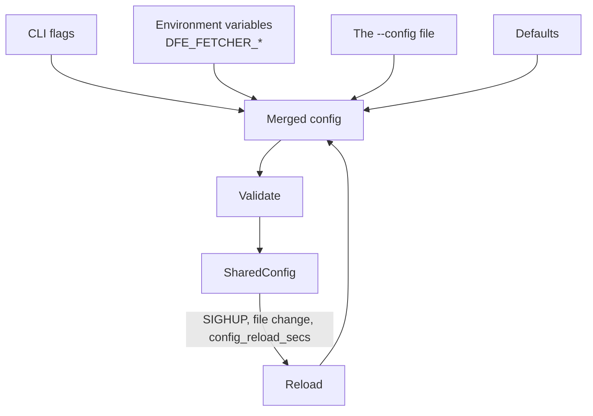
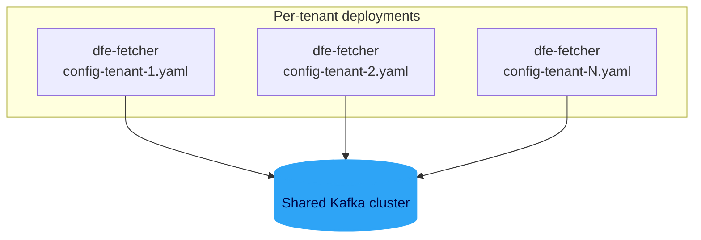

<!-- Project:   dfe-fetcher                          -->
<!-- File:      docs/internals.md                        -->
<!-- Purpose:   Architecture, data flow, and design rationale -->
<!-- Language:  Markdown                               -->
<!--                                                   -->
<!-- License:   BUSL-1.1                               -->
<!-- Copyright: (c) 2026 HYPERI PTY LIMITED            -->

# dfe-fetcher Design Document

## Overview

dfe-fetcher pulls security and operational data from cloud and SaaS providers,
databases, files and external extractors, and delivers each record to the DFE
pipeline over Kafka and/or gRPC. Every provider is a declarative REST profile
run by one generic driver. Databases and files are two more kinds of source on the same
driver. The codemap of the Cargo workspace is
[architecture.md](architecture.md). This document holds the diagrams and
the reasoning.

## High-Level Architecture

Blue cylinders are datastores, rounded faded nodes are external systems,
dotted edges are pushed events. The metrics server (Prometheus, `:9090`) and
the health probes are not drawn.

The container and Vector extractors, their lifecycle, their guarantees and when to choose each over a profile are in [extractors.md](extractors.md).

## Where parsing happens

We parse mechanical transport at max efficiency at the edge. The fetcher parses the framing of the API, file or database it reads (NDJSON lines, a JSON array, CSV rows, a response envelope) into one JSON record per row. Records leave already parsed, with the payload and its fields in the record itself.

The fetcher has no raw capture setting and does not keep the bytes it fetched. Parsing a long text field with grok, dissect or a pipeline is the transforms' job, downstream. A record framed wrongly is fixed in the profile or the driver here. See the fleet rule in [design-principles.md](https://github.com/hyperi-io/dfe-infra/blob/main/docs/design-principles.md).

## Workspace Crates

The repo is a Cargo workspace laid out as a wide DAG off one I/O-free core, so
the source crates compile in parallel and a profile change never rebuilds a
database driver. Solid edges are unconditional. Dashed edges are the optional
engine drivers and the copied Vector tailer, each behind its feature.

The app links all four crates unconditionally, so a `sources.db` or
`sources.file` block is always understood and validated. What the features
decide is whether the ENGINE behind an accepted config is present, which is
why naming an engine this binary lacks is a load error rather than a parse
error.

## Source Framework: One Tick

Every framework source yields rows lazily. The driver runs
each unit of a connection through one loop. A unit is one endpoint, store,
subscription or prefix. Its rows are either events inside the scheduler's
window (incremental) or the whole store (a dump, wrapped in the snapshot
envelope). Rows are polled only while the memory-pressure gate admits them,
so not polling is what pushes back on the provider, and a held source flushes
what it has buffered before it waits. A hold lasts at most
`self_regulation.max_hold_secs`, then the source polls on and logs a warning,
because memory the pause cannot release would otherwise hold it for good.

The checkpoint is the part that makes a failure safe. Each row may carry a
mark (a queue ack id, a manifest item, a keyset tuple, a file offset). The
driver folds the marks of a batch and commits them only after the emitter
reports the batch acknowledged by the transport. A tick that fails commits
nothing more and re-fetches next time, and a queue message is acknowledged to
its broker only after it is on the wire.

A dump scoped per tick opens its snapshot before the first row, so an empty
store lands as an empty snapshot. A directory dump is scoped per file: a
snapshot opens at a file's first row and closes -- `end`, flush, checkpoint --
when the next file starts, so an idle tick publishes nothing and a bad file
leaves the files before it complete and committed.

What a flush does with each record, the dead letters, the guarantee each intake gives, the fields enrichment stamps and a tick with no cursor are in [delivery.md](delivery.md).

## The Profile Grammar

A profile describes an API and carries no identity: a base URL template,
the auth modes the API accepts, headers, the retry policy, where errors live in
a non-2xx body, the window format, and the endpoints with their decoder,
pager and construct. An instance is one deployment of that profile: its
credential kind and refs, `vars`, topic and interval, with per-unit narrowing.
Every struct rejects unknown keys and every enum is a closed vocabulary, so a
typo or an unsupported mode is a load error carrying the YAML line, never a
setting that parses and does nothing. The closed vocabulary (auth modes,
pagers, decoders, constructs, builders, listers), every field and the
validation rules are in
[reference/profile-grammar.md](reference/profile-grammar.md). The grammar as
built is `crates/rest/src/profile/mod.rs`.

## Database and File Sources

A database instance (`sources.db.<id>`) names an engine, its connection
string as a secret spec, the block-cursor bounds and its stores. A `dump`
store selects the whole result set every tick into the snapshot envelope. A
`tail` store selects rows past the last committed key tuple in key order
(`WHERE key > $last ORDER BY key LIMIT n`) and each row carries its key as a
mark, committed after the batch is acknowledged. Engines are opt-in features
so a deployment links only the drivers it ships: `odbc` (unixODBC plus the
engine's own driver, with the SQL dialect named), `clickhouse` (the HTTP
interface, server-side JSON, typed placeholders for the tail) and `mongodb`
(the official driver: a collection dumped by `find`, tailed by change stream
from its resume token or by `_id`). The driver each engine needs, its
licence, whether the image ships it and what its tail commits are tabled in
[docs/reference/db-drivers.md](reference/db-drivers.md). Streaming is the
memory-safety rule, not an optimisation: an engine feeds rows in bounded
blocks, every buffered block is leased on the memory guard, and it stops
fetching when the driver stops polling.

A file instance (`sources.file.<id>`) names its units. A `dump` unit reads
each file its globs match once -- NDJSON, a JSON array or CSV, gzip detected by
magic -- lands each file as its own snapshot, and marks the file done with its
path and change time after its last row is acknowledged, so a file rewritten
in place is read again and a file dropped in by rename is never skipped. A
`tail` unit follows growing files through rotation and truncation on
Vector's file tailer, copied under `third-party/`, and commits `(file fingerprint, end offset)` per line
after the acknowledgement. It needs the `file-tail` feature and is refused at
load without it. A copytruncate that keeps the fingerprint is re-read from byte 0.

| Source | Unit kind | Checkpoint mark | Lands on |
|-------|-----------|-----------------|----------|
| REST profile, incremental | window of events | the scheduler's window cursor (a manifest unit also marks each item) | `<topic>` |
| REST profile, dump | the whole store per tick | none (nothing is incremental) | `<topic>-<unit>` |
| REST profile, queue | pulled messages | ack id per row | `<topic>` |
| DB dump | the whole result set per tick | none | `<topic>-<unit>` |
| DB tail | rows past the last key tuple | key tuple per row (the resume token on a MongoDB change stream) | `<topic>` |
| File dump | each matched file once | file path and change time per row | `<topic>-<unit>` |
| File tail | lines as files grow | fingerprint and end offset per line | `<topic>` |

The deployment's topic suffix (`_land` by default) is appended to every topic
in the table.

A database tail reads its store in pages of `limit` rows inside one tick, each
page resuming past the last row of the one before, and the tick ends on the
first short page or at `max_pages_per_tick`. One query per tick would cap a
unit at `limit / interval` rows a second whatever the table does, and a table
appending faster would fall behind with no signal. `tail_pages_full_total`
counts the pages that came back full, so a store repeatedly hitting the cap is
visible before it is a backlog.

## The Snapshot Envelope

A dump unit's rows travel in an envelope so a consumer can rebuild the whole
store by `snapshot_id` and tell a truncated dump from a complete one: one
`begin` frame, one `row` (or `oversize`) frame per record with a contiguous
`seq`, and one `end` frame carrying the row count, all stamped with the same
UUIDv7 `snapshot_id` and `snapshot_at` and all on the unit's own topic
(`<topic>-<unit>` plus the deployment suffix). A dump that aborts emits no
`end`, which is the consumer-side incompleteness signal. The frames, every
field, the per-tick and per-file scopes and the consumer rules are in
[reference/snapshot-envelope.md](reference/snapshot-envelope.md). The writer
and a reference reassembler are `crates/core/src/envelope.rs`.

A known limitation: a single-destination route moves a dump's matching rows to that destination's table while its `begin` and `end` frames stay in the unit's own, so neither table holds a dump that can be reassembled.

## Configuration Cascade

Earlier layers win. The file is the one `--config` names, and there is no `DFE_FETCHER_CONFIG` variable. Without `--config`, scalo's cascade stands in for the file: `.env` from the working directory, then `settings.<env>.yaml`, `settings.yaml` and `defaults.yaml` from the working directory, `./config/`, `/config/` and the user's config directory. A nested name reaches its key with either separator after the prefix (`DFE_FETCHER_SOURCES__AWS__REGION` and `DFE_FETCHER__SOURCES__AWS__REGION`), an empty value counts as unset, and the flat names `apply_flat_env` reads (`DFE_FETCHER_KAFKA_BROKERS` and the like) are applied last. The runtime's own sections (`logger`, `metrics`, `version_check`) come from the `--config` file, or from scalo's cascade without one.

Validation binds every profile instance (a shipped profile by name or an inline one), every database instance and every file instance, so a bad field fails the load with its path rather than the first tick. Outside the profile grammar a key the config does not know is skipped, and the warning naming it is written before the logger starts, so a misspelt key in a typed block does nothing without a word.

The reloader re-reads the config on SIGHUP, on a change to the `--config` file (polled every `config_reload_secs`, at least 5 s) and every `config_reload_secs` when that is set. A reload that does not validate is refused and the running config kept. Each source reads its filter, the routes, the topic suffix, the org, `unwrap_nested_json`, its batch bounds, the oversize policy and the memory brake once per tick, and the scheduler re-reads the interval, the jitter and the `cursor` window settings. A reload that adds, removes or changes a source starts, stops or rebuilds that source as a restart would, its `env:` and `vault:` specs resolved first. The outputs, the DLQ, the memory guard, the cursor store, `scheduler.max_concurrent_fetches`, the instance id, the ingest listener and the container and Vector extractors are built once, so a change to them needs a restart. On Kubernetes the chart rolls the pod for any config edit outside the deployment contract's `hot_paths` (`crates/fetcher/src/deployment.rs`), so there most edits restart the pod whatever the process could have reloaded.

## Multi-Tenant Deployment

One fetcher per tenant, each with its own config, `instance_id` (the first half
of every cursor key) and credentials. Several accounts of one provider type
can share a fetcher: the typed blocks take a `connections` list, and
`sources.rest` takes any number of instances of one profile, each with its own
connection id. The connection id is the second part of every cursor key, so
ids must differ across every source once case is ignored, and no id may be
another followed by `.`.

## Performance Sensitivity

> **dfe-fetcher is less hot-path-sensitive than the rest of the DFE stack.**

Typical fetcher volumes are orders of magnitude lower than the loader /
receiver / transform / archiver tier, because a provider's API paces what it
hands over. The fetcher is also I/O-bound waiting on remote cloud APIs, not
CPU-bound parsing or routing.

What this means in practice:

| Concern | Rest of DFE stack | dfe-fetcher |
|---|---|---|
| Per-record allocation | Zero-allocation hot path. Pre-allocated pools, arenas | Allocate freely - `Vec`, `String`, `serde_json::Value` are fine |
| SIMD JSON parse | `sonic-rs` mandatory on hot paths | `serde_json` is sufficient |
| Cloning / `Bytes` reuse | Aggressive `Bytes` reuse, `Cow`, arena lifetimes | One allocation per enveloped row is fine |
| Channel sizing | Backpressure-tuned bounded channels per stage | The batcher's bounds and the memory guard's lease are the backpressure |
| `regex` on hot path | Forbidden - use `memchr` / `memmem::Finder` | Acceptable if needed. Volumes don't justify rewrite |
| `async fn` granularity | Watch `.await` budget, yield_now hints | `await` per HTTP request is the unit of work. One virtual `poll_next` per row through a boxed stream |
| Per-source concurrency | Lock-free, sharded, ArcSwap | A mutex around a token cache is acceptable |

We still care about correctness, cancellation safety, bounded retries,
and not leaking tasks - those are correctness concerns, not perf
concerns. We also still prefer the simple, idiomatic version of any
pattern over the clever one. But the aggressive hot-path discipline
applied across dfe-loader / dfe-receiver / dfe-archiver does **not** need to be
applied symmetrically here.

This trade-off is deliberate. It keeps a source a YAML profile rather than
Rust, keeps the driver one readable loop, and reserves the harder
optimisation work for the pipeline tiers where volumes actually demand it.
The two shortcuts the driver takes on purpose -- fetch and emit do not
overlap, and the row stream is boxed -- are marked where they sit in
`crates/fetcher/src/driver.rs` with the measurement that would lift them.
When a fetcher source ever becomes a bottleneck (sustained high-cardinality
tenants, very chatty audit feeds), revisit on a case-by-case basis - the
scalo hot-path patterns are available if needed, just not the default
starting point here.
