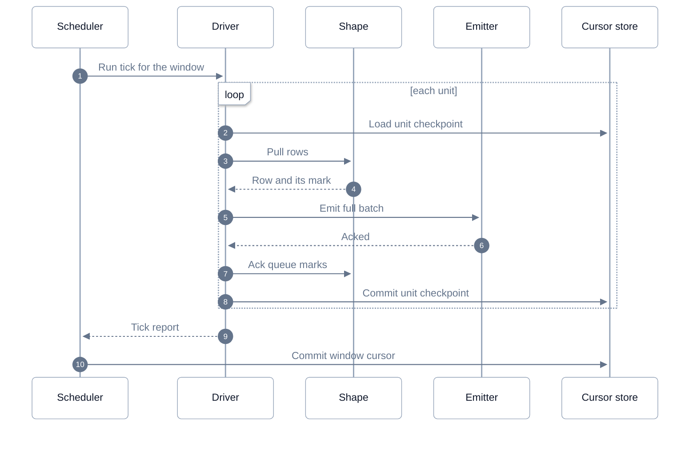
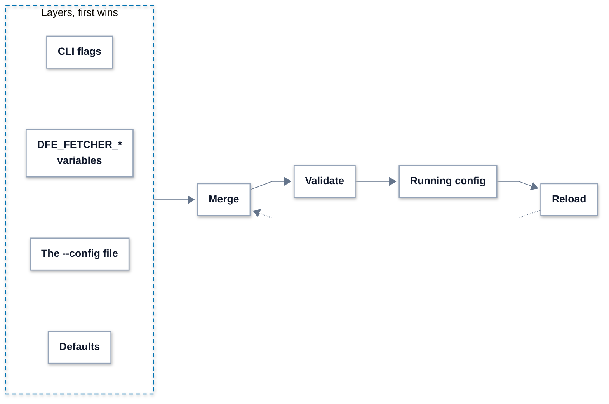
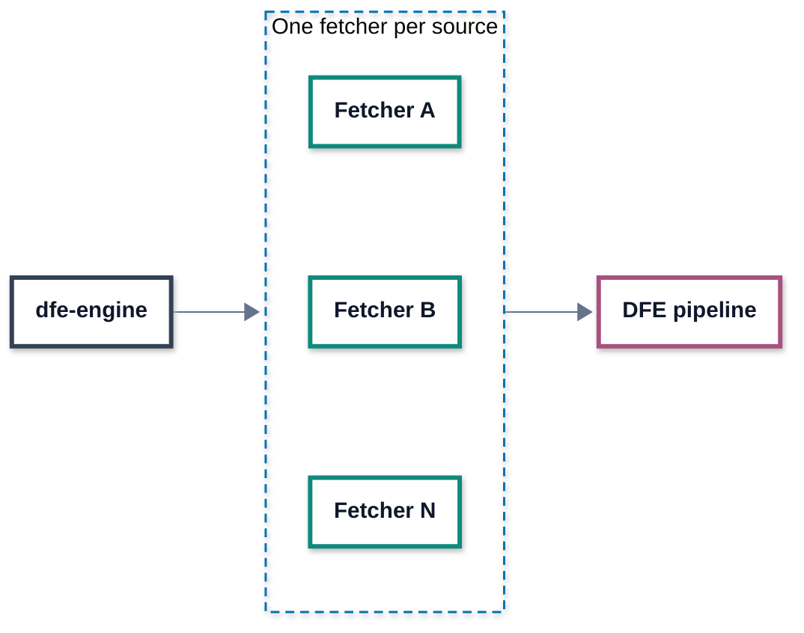

<!-- Project:   dfe-fetcher                          -->
<!-- File:      docs/internals.md                        -->
<!-- Purpose:   Architecture, data flow, and design rationale -->
<!-- Language:  Markdown                               -->
<!--                                                   -->
<!-- License:   BUSL-1.1                               -->
<!-- Copyright: (c) 2026 HYPERI PTY LIMITED            -->

# dfe-fetcher Design Document

## Overview

This page holds the runtime diagrams and the reasoning behind them. The codemap of the Cargo workspace is [architecture.md](architecture.md).

We parse mechanical transport at max efficiency at the edge. The fetcher parses the framing of the API, file or database it reads (NDJSON lines, a JSON array, CSV rows, a response envelope) into one JSON record per row. Records leave parsed, with the payload and its fields in the record itself.

The fetcher has no raw capture setting and does not keep the bytes it fetched. Parsing a long text field with grok, dissect or a pipeline is the transforms' job, downstream. A record framed wrongly is fixed in the profile or the driver here. See the fleet rule in [design-principles.md](https://github.com/hyperi-io/dfe-infra/blob/main/docs/design-principles.md).

## Source framework

A scheduler ticks one driver per connection, and the driver pulls rows through the connection's reader type: `RestShape`, `DbShape` or `FileShape`. The [README](../README.md#architecture) has the diagram this one expands.

The scheduler ticks a driver, which feeds rows from its reader to the emitter and checkpoints to the cursor store.

```mermaid
---
config:
  theme: base
  look: neo
  fontFamily: Inter, -apple-system, Segoe UI, Roboto, Helvetica, Arial, sans-serif
  flowchart:
    curve: linear
    nodeSpacing: 40
    rankSpacing: 64
    padding: 18
    wrappingWidth: 280
    htmlLabels: true
  elk:
    preset: modelOrder
  themeVariables:
    fontSize: 15px
    lineColor: "#64748B"
    primaryTextColor: "#0F172A"
    clusterBorder: "#0072B2"
    edgeLabelBackground: "#FFFFFF"
  themeCSS: >-
    p{margin:0}
    .node[data-look] rect,.node[data-look] path,.node[data-look] polygon,.node[data-look] .outer-path{filter:drop-shadow(0 1px 2px rgba(15,23,42,.10)) drop-shadow(0 6px 14px rgba(15,23,42,.10))}
    .node rect{rx:10px;ry:10px}
    .cluster rect{rx:16px;ry:16px}
    .node .label div{min-width:150px}
    .node.decision .label div{min-width:0}
    .cluster[data-look] rect{filter:none}
    .nodeLabel{line-height:1.35}
    .nodeLabel b{font-weight:600;font-size:15px;letter-spacing:-0.01em}
    .nodeLabel span{font-size:12.5px;font-weight:400;color:#334155}
    .cluster-label span.nodeLabel{display:inline-block;background:#FFFFFF;color:#0B2A3F;border:1.5px solid #0072B2;border-radius:999px;padding:2px 12px;font-size:11.5px;font-weight:700;letter-spacing:.09em;text-transform:uppercase}
    .flowchart-link{stroke-width:1.75px}
    .labelBkg{background:transparent!important}
    span.edgeLabel{display:inline-block;background:#FFFFFF!important;color:#1E293B;border:1px solid #94A3B8;border-radius:999px;padding:2px 10px;font-size:12px;font-weight:500}
    span.edgeLabel p{background:transparent!important}
    .label-icon{width:20px;height:20px;vertical-align:-4px;margin-right:6px}
    .ingest .label-icon{color:#0E8A7D}
    .xform .label-icon{color:#7B4FB0}
    .load .label-icon{color:#0072B2}
    .bus .label-icon{color:#A8517F}
    .store .label-icon{color:#00785A}
    .ui .label-icon{color:#D9480F}
    .ext .label-icon{color:#64748B}
---
flowchart LR
    accTitle: L4 Detail -- Source framework
    accDescr: APIs, databases and files feed a connection's shape. The scheduler ticks the connection's driver, which pulls rows from the shape, commits each unit's checkpoint to the cursor store and hands records to the emitter.

    providers["<b>APIs, databases, files</b>"]

    subgraph framework["Source framework"]
        shape["<b>Shape</b><br/><span>REST, DB or file</span>"]
        scheduler["<b>Scheduler</b>"]
        driver[["<b>Driver</b>"]]
        cursor[("<b>Cursor store</b>")]
    end

    emitter["<b>Emitter</b>"]

    providers -->|records| shape
    shape --> driver
    scheduler --> driver
    driver --> cursor
    framework -->|records| emitter
  classDef ext fill:#F4F6F8,stroke:#94A3B8,stroke-width:1.5px,stroke-dasharray:5 4,color:#0F172A
  classDef ingest fill:#FFFFFF,stroke:#0E8A7D,stroke-width:3px,color:#0F172A
  classDef xform fill:#FFFFFF,stroke:#7B4FB0,stroke-width:3px,color:#0F172A
  classDef load fill:#FFFFFF,stroke:#0072B2,stroke-width:3px,color:#0F172A
  classDef bus fill:#FFFFFF,stroke:#A8517F,stroke-width:3px,color:#0F172A
  classDef store fill:#FFFFFF,stroke:#00785A,stroke-width:3px,color:#0F172A
  classDef ui fill:#FFFFFF,stroke:#D9480F,stroke-width:3px,color:#0F172A
  classDef decision fill:#FFFFFF,stroke:#9A6700,stroke-width:3px,color:#0F172A
  classDef error fill:#FFFFFF,stroke:#C2410C,stroke-width:3px,color:#0F172A
  classDef control fill:#FFFFFF,stroke:#334155,stroke-width:3px,color:#0F172A
  classDef part fill:#FFFFFF,stroke:#94A3B8,stroke-width:1.5px,color:#0F172A
  class providers ext
  class shape,scheduler,driver,emitter part
  class cursor store
  style framework fill:none,stroke:#0072B2,stroke-width:1.5px,stroke-dasharray:6 4
```

*Figure 1. L4 Detail -- Source framework. The dashed box is external.* Up: [L3 Components -- dfe-fetcher](../README.md#architecture). Down: [L4 Detail -- One tick](#one-tick).

The scheduler writes each connection's window cursor to the cursor store once a tick succeeds, one JSON file per key.

## One tick

The driver runs each unit of a connection through one loop, pulling rows lazily. A unit is one endpoint, store,
subscription or prefix. Its rows are either events inside the scheduler's
window (incremental) or the whole store (a dump, wrapped in the snapshot
envelope). Rows are not polled unless the memory-pressure gate admits them,
so not polling is what pushes back on the provider, and a held source flushes
what it has buffered before it waits. A hold lasts at most
`self_regulation.max_hold_secs`, then the source polls on and logs a warning,
because memory the pause cannot release would otherwise hold it for good.

Each row may have a
mark (a queue ack id, a manifest item, a keyset tuple, a file offset). The
driver folds the marks of a batch and commits them once the emitter
reports the batch acknowledged by the transport. A tick that fails commits
nothing more and re-fetches next time, and a queue message is acknowledged to
its broker once it is on the wire, never before.

A tick commits each unit's checkpoint after the emitter acknowledges its last batch.

*Figure 2. L4 Detail -- One tick. Solid arrows are requests and dashed arrows are answers.* Up: [L4 Detail -- Source framework](#source-framework).

Between pulling a row and batching it, the driver unwraps nested JSON, wraps a dump row in the envelope, stubs an oversize row, applies the rules (filter, routes, added fields) and enriches the record. A batched row leases its bytes on the memory guard. A batch is emitted when it reaches `accumulate.max_rows`, `max_bytes` or `window_ms`, and the last one when the unit's rows end.

A dump scoped per tick opens its snapshot before the first row, so an empty
store lands as an empty snapshot. A directory dump is scoped per file: a
snapshot opens at a file's first row and closes -- `end`, flush, checkpoint --
when the next file starts, so an idle tick publishes nothing and a bad file
leaves the files before it complete and committed.

What a flush does with each record, the dead letters, the guarantee each intake gives, the fields enrichment stamps and a tick with no cursor are in [delivery.md](delivery.md).

## The Profile Grammar

A profile describes an API with no identity, and an instance binds it to one deployment's credentials, `vars`, topic and interval. Every struct rejects unknown keys and every enum is a closed vocabulary, so a typo or an unsupported mode is a load error carrying the YAML line, never a setting that parses and does nothing. Every field is in [reference/profile-grammar.md](reference/profile-grammar.md), and the grammar as built is `crates/rest/src/profile/mod.rs`.

## Database and File Sources

A database instance (`sources.db.<id>`) names an engine, its connection
string as a secret spec, the block-cursor bounds and its stores. A `dump`
store selects the whole result set every tick into the snapshot envelope. A
`tail` store selects rows past the last committed key tuple in key order
(`WHERE key > $last ORDER BY key LIMIT n`) and each row has its key as a
mark, committed after the batch is acknowledged. The engines (`odbc`, `clickhouse`, `mongodb`), the driver each needs and what its tail commits are in [reference/db-drivers.md](reference/db-drivers.md). Streaming is the
memory-safety rule, not an optimisation: an engine feeds rows in bounded
blocks, every buffered block is leased on the memory guard, and it stops
fetching when the driver stops polling.

A file instance (`sources.file.<id>`) names its units. A `dump` unit reads
each file its globs match once -- NDJSON, a JSON array or CSV, gzip detected by
magic -- lands each file as its snapshot, and marks the file done with its
path and change time after its last row is acknowledged, so a file rewritten
in place is read again and a file dropped in by rename is never skipped. A
`tail` unit follows growing files through rotation and truncation on
Vector's file tailer, copied under `third-party/`, and commits `(file fingerprint, end offset)` per line
after the acknowledgement. It keeps the tailer's checkpoint file in its
`data_dir`, which defaults to `<cursor.directory>/<instance_id>.<id>.<unit>.tail`
(lowercased, beside the unit's cursor file). It needs the `file-tail` feature
and is refused at load without it. A copytruncate that keeps the fingerprint is re-read from byte 0.

| Source | Unit kind | Checkpoint mark | Lands on |
|-------|-----------|-----------------|----------|
| REST profile, incremental | window of events | the scheduler's window cursor (a manifest unit marks each item) | `<topic>` |
| REST profile, dump | the whole store per tick | none (nothing is incremental) | `<topic>-<unit>`, or `<topic>` with `topic_per_dump_unit: false` |
| REST profile, queue | pulled messages | ack id per row | `<topic>` |
| DB dump | the whole result set per tick | none | `<topic>-<unit>`, or `<topic>` with `topic_per_dump_unit: false` |
| DB tail | rows past the last key tuple | key tuple per row (the resume token on a MongoDB change stream) | `<topic>` |
| File dump | each matched file once | file path and change time per row | `<topic>-<unit>`, or `<topic>` with `topic_per_dump_unit: false` |
| File tail | lines as files grow | fingerprint and end offset per line | `<topic>` |

The deployment's topic suffix (`_land` by default) is appended to every topic
in the table.

A database tail reads its store in pages of `limit` rows inside one tick, each
page resuming past the last row of the one before, and the tick ends on the
first short page or at `max_pages_per_tick`. One query per tick would cap a
unit at `limit / interval` rows a second whatever the table does, and a table
appending faster would fall behind with no signal. `dfe_fetcher_tail_pages_full_total`
counts the pages that came back full, so a store repeatedly hitting the cap is
visible before it is a backlog.

## The Snapshot Envelope

A dump unit's rows travel as one `begin` frame, a `row` (or `oversize`) frame per record and one `end` frame carrying the row count, all under one UUIDv7 `snapshot_id` on the unit's topic. A consumer rebuilds the store by `snapshot_id`, and a dump with no `end` was cut short. The frames and the consumer rules are in [reference/snapshot-envelope.md](reference/snapshot-envelope.md).

A known limitation: a single-destination route moves a dump's matching rows to that destination's table, and its `begin` and `end` frames stay in the unit's table, so neither table holds a dump that can be reassembled.

## Configuration Cascade

Four layers merge, the first winning, and a reload runs the merge again.

*Figure 3. L4 Detail -- Configuration cascade. The dotted arrow is a reload on SIGHUP, a file change or every `config_reload_secs`.* Up: [dfe-fetcher documentation](README.md).

The file is the one `--config` names, and there is no `DFE_FETCHER_CONFIG` variable. Without `--config`, scalo's cascade stands in for the file: `.env` from the working directory, then `settings.<env>.yaml`, `settings.yaml` and `defaults.yaml` from the working directory, `./config/`, `/config/` and the user's config directory. A nested name reaches its key with either separator after the prefix (`DFE_FETCHER_SOURCES__AWS__REGION` and `DFE_FETCHER__SOURCES__AWS__REGION`), an empty value counts as unset, and the flat names `apply_flat_env` reads (`DFE_FETCHER_KAFKA_BROKERS` and the like) are applied last. The runtime's sections (`logger`, `metrics`, `version_check`) come from the `--config` file, or from scalo's cascade without one.

Validation binds every profile, database and file instance, so a bad field fails the load with its path rather than the first tick. Outside the profile grammar a key the config does not know is skipped and logged once the logger is up: a key inside a section at WARN, because a misspelt key does nothing, and a top-level key at INFO, because it may be a section the scalo runtime reads.

The file is polled for a change at least every 5 s. A reload that does not validate is refused and the running config kept. Each source reads its filter, the routes, the topic suffix, the org, `unwrap_nested_json`, its batch bounds, the oversize policy and the memory brake once per tick, and the scheduler re-reads the interval, the jitter and the `cursor` window settings. A reload that adds, removes or changes a source starts, stops or rebuilds that source as a restart would, its `env:` and `vault:` specs resolved first. The outputs, the DLQ, the memory guard, the cursor store, `scheduler.max_concurrent_fetches`, the instance id, the ingest listener and the container and Vector extractors are built once, so a change to them needs a restart. On Kubernetes the chart rolls the pod for any config edit outside the deployment contract's `hot_paths` (`crates/fetcher/src/deployment.rs`), so there most edits restart the pod whatever the process could have reloaded.

## Deployments

A DFE deployment on Kubernetes runs one fetcher per configured source: dfe-engine writes the fetcher's deployment when the source is written, each with a separate config, `instance_id` (the first half of every cursor key) and credentials. The docker single-host profile runs one fetcher holding every source instead.

dfe-engine writes one fetcher per configured source, and every fetcher sends to the same DFE pipeline.

*Figure 4. L4 Detail -- Fetcher deployments.* Up: [dfe-fetcher documentation](README.md).

Several accounts of one provider type
can share a fetcher: the typed blocks take a `connections` list, and
`sources.rest` takes any number of instances of one profile, each with a separate
connection id. The connection id is the second part of every cursor key, so
ids must differ across every source once case is ignored, and no id may be
another followed by `.`.
