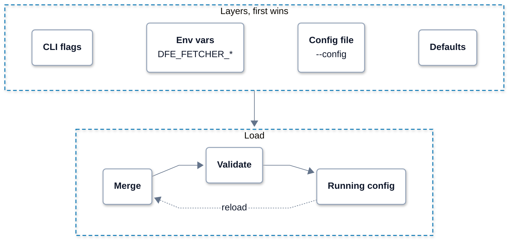

<!-- Project:   dfe-fetcher                                        -->
<!-- File:      docs/reference/configuration.md                    -->
<!-- Purpose:   How the configuration loads, and what reloads      -->
<!-- Language:  Markdown                                           -->
<!--                                                               -->
<!-- License:   BUSL-1.1                                           -->
<!-- Copyright: (c) 2026 HYPERI PTY LIMITED                        -->

# Configuration cascade

Four layers merge, the first winning, and a reload runs the merge again.

*Figure 1. L4 Detail -- Configuration cascade. The reload arrow fires on SIGHUP, a file change or every `config_reload_secs`.* Up: [L3 Components -- dfe-fetcher](../architecture.md).

The file is the one `--config` names, and there is no `DFE_FETCHER_CONFIG` variable. Without `--config`, scalo's cascade stands in for the file: `.env` from the working directory, then `settings.<env>.yaml`, `settings.yaml` and `defaults.yaml` from the working directory, `./config/`, `/config/` and the user's config directory. A nested name reaches its key with either separator after the prefix (`DFE_FETCHER_SOURCES__AWS__REGION` and `DFE_FETCHER__SOURCES__AWS__REGION`), and an empty value counts as unset. The flat names `apply_flat_env` reads (`DFE_FETCHER_KAFKA_BROKERS` and the like) are applied last. The runtime's sections (`logger`, `metrics`, `version_check`) come from the `--config` file, or from scalo's cascade without one.

Validation binds every profile, database and file instance, so a bad field fails the load with its path rather than the first tick. Outside the profile grammar a key the config does not know is skipped and logged once the logger is up. A key inside a section logs at WARN, because a misspelt key does nothing. A top-level key logs at INFO, because it may be a section the scalo runtime reads.

## What reloads

The file is polled for a change at least every 5 s. A reload that does not validate is refused and the running config kept.

Each source reads its filter, the routes, the topic suffix, the org, `unwrap_nested_json`, its batch bounds, the oversize policy and the memory brake once per tick. The scheduler re-reads the interval, the jitter and the `cursor` window settings. A reload that adds, removes or changes a source starts, stops or rebuilds that source as a restart would, its `env:` and `vault:` specs resolved first.

The outputs, the DLQ, the memory guard, the cursor store, `scheduler.max_concurrent_fetches`, the instance id, the ingest listener and the container and Vector extractors are built once, so a change to them needs a restart. On Kubernetes the chart rolls the pod for any config edit outside the deployment contract's `hot_paths` (`crates/fetcher/src/deployment.rs`), so there most edits restart the pod whatever the process could have reloaded.
